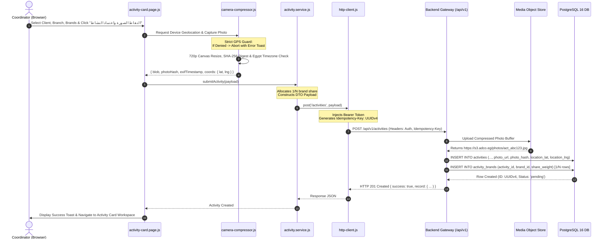

# ADCO Field Operations Platform — Master Architecture & Data Flow Blueprint

> **System Version:** 2.0.0 Modern Web Architecture  
> **Target Framework:** Clean Vanilla ES Modules + Modern CSS Variables Design System  
> **Backend Integration:** RESTful JSON API v1 / PostgreSQL 16 / S3-Compatible Media Store  
> **Timezone Requirement:** `Africa/Cairo` (UTC+2)  

---

## 1. Clean Repository Map & Architecture Blueprint

```
adco-field-app/
├── ARCHITECTURE_AND_DATA_FLOW.md    # Master Architecture, Data Flow & Type Matrix Blueprint
├── index.html                       # Seamless Root Entry & Vercel Redirect Gateway
├── manifest.json                    # PWA Web App Manifest
├── sw.js                            # Offline Service Worker (Cache First for Static Assets)
├── run-app.bat                      # Windows Desktop Local Launcher
├── vercel.json                      # Vercel Production Routing & Clean URL Rewrites
└── frontend/
    ├── index.html                   # Authenticated Landing Shell & Session Resume Gate
    ├── manifest.json                # PWA Manifest (Scoped to /frontend/)
    ├── sw.js                        # PWA Service Worker (Scoped to /frontend/)
    ├── assets/
    │   ├── icons/                   # 29 Production Feather/Lucide SVG UI Icons
    │   └── images/                  # Transparent Brand Logo, Avatars, Medals & Ambient Art
    │       ├── ADCO-logo.png        # Transparent 32-bit ARGB Alpha Channel Brand Logo
    │       ├── auth-hero-bg.svg     # Ambient SVG Mesh Gradient for Split Auth View
    │       ├── avatar-coordinator.svg # Default Coordinator SVG Avatar
    │       ├── avatar-supervisor.svg  # Default Supervisor SVG Avatar
    │       ├── medal-gold.svg       # Rank 1 Leaderboard Trophy Badge
    │       ├── medal-silver.svg     # Rank 2 Leaderboard Trophy Badge
    │       └── medal-bronze.svg     # Rank 3 Leaderboard Trophy Badge
    ├── css/
    │   ├── variables.css            # Design tokens: ADCO green palette, typography, radii, z-indices
    │   ├── base.css                 # CSS resets, RTL bidirectional rules, desktop 100vw layout
    │   ├── layout.css               # Sticky website navbar, split-screen auth, multi-column responsive grids
    │   └── components.css           # Modern button variants, searchable comboboxes, data tables, modals, toast
    ├── js/
    │   ├── config/
    │   │   ├── constants.js         # Immutable global enums: ROLES, ACTIVITY_STATUS, EVALUATION_CRITERIA
    │   │   ├── catalogs.js          # ADCO master catalog (Clients, Branches, Activities, Brands, SKUs)
    │   │   └── endpoints.js         # Standardized API endpoint dictionary for backend routes
    │   ├── api/
    │   │   └── http-client.js       # Fetch client: JWT Bearer injection, Idempotency-Key UUID, 401 refresh
    │   ├── services/
    │   │   ├── auth.service.js      # Login, 3-step signup, token persistence, role switcher & session guard
    │   │   ├── activity.service.js  # Activity CRUD, 1/N brand multiplication, follow-up photos, closure workflow
    │   │   ├── media.service.js     # Strict hardware GPS geolocation verification, EXIF parsing, camera compression
    │   │   ├── evaluation.service.js# Supervisor 100-pt review, tier badge scoring, activity date adjustments
    │   │   ├── profile.service.js   # Change password & contact info updates
    │   │   └── reporting.service.js # CSV export with start/end date ranges, analytics metrics & leaderboard rank
    │   ├── components/
    │   │   ├── navbar.js            # Sticky modern top navbar with role-aware switcher (hides rank in supervisor mode)
    │   │   ├── profile-modal.js     # Floating modal for password unlock gate, credential updates & profile card
    │   │   ├── combobox.js          # Searchable single-select and multi-select combobox component
    │   │   └── toast.js             # SVG-powered non-blocking notification toast queue
    │   ├── utils/
    │   │   ├── validators.js        # Egyptian phone, national ID, employee code, email, password strength validators
    │   │   ├── camera-compressor.js # 720p client canvas compression, SHA-256 byte hashing, EXIF parser, Cairo time
    │   │   ├── offline-queue.js     # IndexedDB offline store with auto-sync on browser 'online' event
    │   │   └── score-calculator.js  # 100-point formula (40 New, 20 Quality, 25 Continuity, 15 Documentation)
    │   └── pages/
    │       ├── login.page.js        # Split-screen auth controller with show-password toggle
    │       ├── signup.page.js       # 3-step employee wizard controller with validation & error handling
    │       ├── dashboard.page.js    # Metric summary badges, fast-action launcher & coordinator cards feed
    │       ├── activity-card.page.js# Activity creation, live GPS camera capture, follow-up timeline & completion
    │       ├── supervisor.page.js   # 100-point evaluation workspace, date editor, session approval & reject flow
    │       ├── sheets.page.js       # Enterprise data grid with date range filters, multi-column search & CSV export
    │       ├── analytics.page.js    # Chart-ready metrics (brand share, branch execution, completion velocity)
    │       └── leaderboard.page.js  # Ranked coordinator standings, score tier badges & performance medals
    └── pages/
        ├── login.html               # Split-screen Login View
        ├── signup-wizard.html       # 3-Step Coordinator/Supervisor Registration View
        ├── dashboard.html           # Main Operational Hub View
        ├── activity-card.html       # Activity Card View (Create, Follow-Up, Complete)
        ├── supervisor-panel.html    # Supervisor Evaluation & Review Workspace
        ├── sheets-view.html         # Tabular Operational Data Grid & Export
        ├── analytics.html           # KPI & Analytical Performance Reports
        └── leaderboard.html         # Performance Standings & Honor Board
```

---

## 2. Screen-by-Screen Data Inputs & Validation Rules

### 2.1 Authentication: Login (`login.html`)
* **Inputs:**
  * `employeeId` (Text, trimmed): Required, 3–20 alphanumeric chars (`/^[A-Za-z0-9_-]{3,20}$/`).
  * `password` (Password with show/hide toggle): Required, minimum 6 chars.
  * `rememberMe` (Checkbox): Persists session token in `localStorage` vs. `sessionStorage`.
* **Actions:** Validates credentials via `POST /api/v1/auth/login`. On success, stores JWT `{accessToken, refreshToken, user}` and redirects to `dashboard.html`.

### 2.2 Registration: 3-Step Wizard (`signup-wizard.html`)
* **Step 1: Identity & Credentials:**
  * `fullName` (Text): 3–100 chars, Arabic or English full name.
  * `employeeId` (Text): 3–20 alphanumeric characters, must be unique.
  * `role` (Select): `coordinator` (منسق ميداني) or `supervisor` (مشرف عمليات).
  * `password` (Password): Min 8 chars, at least 1 uppercase, 1 lowercase, 1 number.
  * `confirmPassword` (Password): Must match `password` identically.
* **Step 2: Contact & Regional Assignment:**
  * `phone` (Tel): Egyptian mobile regex `^01[0125][0-9]{8}$`.
  * `email` (Email): Standard RFC-5322 email regex.
  * `assignedRegion` (Select): Alexandria, Cairo, Giza, Delta, Upper Egypt, Canal.
* **Step 3: Verification & Security Agreement:**
  * `termsAccepted` (Checkbox): Mandatory `true`.
  * `identityCardPhoto` (File, Optional): National ID / Employee badge image.
* **Actions:** Submits `POST /api/v1/auth/signup`. Auto-logs in on HTTP 201.

### 2.3 Activity Card: Creation (`activity-card.html`)
* **Fields & Rules:**
  * `client` (Combobox): Selected from `ADCO_CATALOGS.clients` (e.g. كارفور, لولو ماركت, فتح الله).
  * `branch` (Combobox): Dependent on `client`, selected from `ADCO_CATALOGS.branches[client]`.
  * `coordinatorBranch` (Combobox): Base distribution center (e.g. فرع الإسكندرية, فرع برج العرب).
  * `activity` (Select): Main activity catalog (e.g. فرشة مجلة, رأس جزيرة, ستاند خاص, أندكاب, كورنر).
  * `activityType` (Select): `نشاط جديد` (New Activity) or `امتداد لنشاط قائم` (Continuation).
  * `activityCount` (Number): Integer $\ge 1$.
  * `brands` (Multi-Select Combobox): At least 1 brand selected. Automatically allocates $1/N$ brand weight share per selected brand.
  * `skuVariant` (Select): Dependent on selected brands.
  * `activityDate` (Datetime-Local): Defaults to current Egypt timestamp (`Africa/Cairo`). Editable by coordinator at creation time.
  * `magazineDate` (Date): **Mandatory condition:** Required IF AND ONLY IF `activity === 'فرشة مجلة'`. Otherwise omitted or null.
  * `initialPhoto` (File / Live Camera Capture): Mandatory live capture. Requires browser Geolocation API access; if location is denied, photo submission is blocked. Compressed to max 720p and 1MB size, SHA-256 byte digest computed, EXIF metadata extracted and verified against Egypt timezone.
* **Actions:** Dispatches `POST /api/v1/activities` with multipart form/JSON payload.

### 2.4 Activity Card: Follow-Up Sessions & Completion (`activity-card.html?id=:id`)
* **Follow-up Photo Upload:**
  * Requires live camera capture with device GPS lock.
  * Appends photo session to activity timeline with timestamp, geographic coordinates, and client SHA-256 hash.
* **Request Activity Completion (طلب إنهاء النشاط):**
  * `closingNote` (Textarea, Optional): Notes from coordinator.
  * `finalPhoto` (Camera Capture, Required): Proof of activity status at conclusion.
  * Triggers transition to `pending_closure` status.

### 2.5 Supervisor Panel (`supervisor-panel.html`)
* **100-Point Evaluation Matrix Inputs:**
  * `approvedNewActivities` (Number, 0–40): Points for new location initiative and compliance.
  * `executionQuality` (Number, 0–20): Visual branding, SKU arrangement, and shelf hygiene.
  * `provenContinuityDuration` (Number, 0–25): Duration and maintenance across follow-up sessions.
  * `documentationAccuracy` (Number, 0–15): Exact location metadata, timely uploads, and photo clarity.
  * `supervisorNotes` (Textarea, Optional): Qualitative feedback.
  * `editActivityDate` (Datetime-Local, Optional): Supervisor can adjust activity date anytime.
* **Actions:**
  * `POST /api/v1/supervisor/evaluations` (Approves card, updates score, sets status to `approved`).
  * `POST /api/v1/activities/:id/reject` (Returns card to coordinator with required modifications).
  * `POST /api/v1/activities/:id/close` (Approves completion, stamps `activityEndDate` with Egypt timestamp).

### 2.6 Enterprise Sheets View (`sheets-view.html`)
* **Filters:**
  * `startDate` & `endDate` (Date Range Filter): Filters rows by `activityDate` or creation timestamp.
  * `clientFilter` & `branchFilter` (Select): Filter by store chains.
  * `statusFilter` (Select): All, Pending, Approved, Rejected, Pending Closure, Closed.
  * `searchQuery` (Text): Instant text filtering on coordinator name, ID, or activity code.
* **Actions:** `GET /api/v1/supervisor/sheets-view`, CSV Export with Start & End timestamps.

---

## 3. End-to-End Request Journey Trace



---

## 4. Strict Data Type Matrix for Every System Attribute

| Attribute / Field Name | UI Input Type | Frontend JS Type | API JSON Schema / Zod Rule | PostgreSQL 16 Column Type | Nullable | Notes / Validation Constraints |
|:---|:---|:---|:---|:---|:---:|:---|
| **`id`** | Hidden / URL Param | `string` | `z.string().uuid()` | `UUID PRIMARY KEY` | No | RFC 4122 v4 Unique Identifier |
| **`coordinatorId`** | Hidden (from session) | `string` | `z.string().min(3).max(20)` | `VARCHAR(20)` | No | FK referencing `users(employee_id)` |
| **`coordinatorName`** | Readonly Text | `string` | `z.string().min(3).max(100)` | `VARCHAR(100)` | No | Snapshot of coordinator full name |
| **`client`** | Combobox Single | `string` | `z.string().min(2).max(80)` | `VARCHAR(80)` | No | Client store chain from catalog |
| **`branch`** | Combobox Single | `string` | `z.string().min(2).max(100)` | `VARCHAR(100)` | No | Client retail store branch |
| **`coordinatorBranch`** | Select Single | `string` | `z.string().min(2).max(100)` | `VARCHAR(100)` | No | ADCO regional logistics center |
| **`activity`** | Select Single | `string` | `z.string().min(2).max(80)` | `VARCHAR(80)` | No | Main activity type (e.g. فرشة مجلة) |
| **`activityType`** | Radio / Select | `string` | `z.enum(['نشاط جديد', 'امتداد لنشاط قائم'])` | `VARCHAR(40)` | No | Determines 40-pt scoring baseline |
| **`activityCount`** | Number Input | `number` | `z.number().int().min(1).max(100)` | `SMALLINT DEFAULT 1` | No | Quantity of displays installed |
| **`brands`** | Combobox Multiple | `string[]` | `z.array(z.string()).min(1)` | `TEXT[]` or relation table | No | Selected brands (allocates $1/N$ share) |
| **`brandShareSplit`** | Computed Display | `number` | `z.number().min(0.01).max(1.0)` | `NUMERIC(5, 4)` | No | Mathematical calculation: $1 / \text{brands.length}$ |
| **`skuVariant`** | Select Single | `string` | `z.string().min(2).max(100)` | `VARCHAR(100)` | No | Master SKU variant |
| **`activityDate`** | Datetime-Local | `string` | `z.string().datetime({ offset: true }).or(z.string().regex(/^\d{4}-\d{2}-\d{2}T\d{2}:\d{2}/))` | `TIMESTAMPTZ` | No | Defaults to current Cairo timestamp |
| **`activityEndDate`** | Display / Auto-set | `string \| null` | `z.string().datetime().nullable()` | `TIMESTAMPTZ` | Yes | Set upon closure approval |
| **`magazineDate`** | Date Input | `string \| null` | `z.string().regex(/^\d{4}-\d{2}-\d{2}$/).nullable()` | `DATE` | Yes | **Mandatory only if** `activity === 'فرشة مجلة'` |
| **`status`** | Status Badge | `string` | `z.enum(['pending', 'approved', 'rejected', 'pending_closure', 'closed'])` | `VARCHAR(24) DEFAULT 'pending'` | No | Controlled by lifecycle state machine |
| **`photoUrl`** | File / Live Image | `string` | `z.string().url()` | `VARCHAR(512)` | No | S3 HTTPS CDN storage URL |
| **`photoHash`** | Cryptographic Digest | `string` | `z.string().length(64).regex(/^[a-f0-9]{64}$/)` | `CHAR(64)` | No | Client SHA-256 byte integrity hash |
| **`latitude`** | Geolocation Sensor | `number` | `z.number().min(-90).max(90)` | `NUMERIC(10, 7)` | No | Hardware GPS reading |
| **`longitude`** | Geolocation Sensor | `number` | `z.number().min(-180).max(180)` | `NUMERIC(10, 7)` | No | Hardware GPS reading |
| **`locationAccuracy`**| Geolocation Sensor | `number` | `z.number().min(0)` | `NUMERIC(6, 2)` | Yes | GPS margin of error in meters |
| **`exifTimestamp`** | EXIF Parser | `string` | `z.string().datetime()` | `TIMESTAMPTZ` | Yes | Camera shutter capture timestamp |
| **`evalScore`** | Metric Display | `number \| null` | `z.number().min(0).max(100).nullable()` | `SMALLINT` | Yes | Total 100-pt review score |
| **`evalCriteriaNew`** | Number Input (0–40) | `number` | `z.number().min(0).max(40).default(0)` | `SMALLINT DEFAULT 0` | No | Approved New Activities criterion (40 pts) |
| **`evalCriteriaQuality`**| Number Input (0–20) | `number` | `z.number().min(0).max(20).default(0)` | `SMALLINT DEFAULT 0` | No | Execution Quality criterion (20 pts) |
| **`evalCriteriaContinuity`**| Number Input (0–25)| `number` | `z.number().min(0).max(25).default(0)` | `SMALLINT DEFAULT 0` | No | Proven Continuity criterion (25 pts) |
| **`evalCriteriaDocs`**| Number Input (0–15) | `number` | `z.number().min(0).max(15).default(0)` | `SMALLINT DEFAULT 0` | No | Documentation Accuracy criterion (15 pts) |
| **`evalNotes`** | Textarea | `string \| null` | `z.string().max(500).nullable()` | `VARCHAR(500)` | Yes | Supervisor qualitative assessment notes |
| **`evaluatedAt`** | System Timestamp | `string \| null` | `z.string().datetime().nullable()` | `TIMESTAMPTZ` | Yes | Evaluation decision timestamp |
| **`evaluatedBy`** | Hidden (from session) | `string \| null` | `z.string().min(3).max(20).nullable()`| `VARCHAR(20)` | Yes | FK referencing `users(employee_id)` |
| **`createdAt`** | System Timestamp | `string` | `z.string().datetime()` | `TIMESTAMPTZ DEFAULT NOW()` | No | Record creation timestamp |
| **`updatedAt`** | System Timestamp | `string` | `z.string().datetime()` | `TIMESTAMPTZ DEFAULT NOW()` | No | Last record update timestamp |

---

## 5. Security, Idempotency & Offline Synchronization

1. **Authorization Token Lifecycle:**
   * Short-lived JWT `accessToken` (15 min) stored in browser memory/session.
   * Long-lived `refreshToken` (7 days) stored in HttpOnly secure cookie or partitioned local storage.
   * Automatic interceptor in `frontend/js/api/http-client.js` transparently executes token renewal upon receiving HTTP `401 Unauthorized`.
2. **Idempotent Write Operations:**
   * Every state-mutating request (`POST`, `PUT`, `PATCH`, `DELETE`) automatically generates an RFC 4122 v4 UUID attached in the `Idempotency-Key` header.
   * Backend caches request keys in Redis for 120 seconds to prevent double-billing, duplicate activity creation, or concurrent supervisor reviews under unstable network conditions.
3. **Strict Hardware Geolocation & Image Integrity:**
   * Coordinator camera capture enforces browser `navigator.geolocation.getCurrentPosition({ enableHighAccuracy: true })`.
   * If permission is revoked or denied, activity card submission is blocked immediately with an explicit prompt.
   * Images are downscaled to 720p using an offscreen `<canvas>` with progressive JPEG compression target `< 1MB`.
   * A cryptographic SHA-256 byte digest is computed client-side before upload to prevent image tampering in transit.
4. **Offline Resilience (IndexedDB Queue):**
   * If the mobile device loses connectivity during field audits, submissions are persisted locally in IndexedDB store `adco_offline_db.pending_actions`.
   * The app listens to the browser `window.addEventListener('online', ...)` event to automatically replay queued submissions in FIFO sequence with exponential backoff.
