# ADCO Field Operations Platform: Final System Design

> **Version:** 3.0
> **Company:** (ADCO) شركة الإسكندرية للكيماويات والمنظفات
> **Timezone:** Africa/Cairo (UTC+2)
> **Contents:** Part 1 is the system specification (requirements, business rules, architecture, data model, security, deployment). Part 2 is the system diagrams (workflows, service interactions, database, and sequences). Items marked **[ASSUMED]** need confirmation before development. Where the original endpoint and architecture drafts conflict with this document, this document governs (see Part 1, section 20).

## Table of contents

- **Part 1: Specification**
  1. Purpose and scope
  2. Scale and assumptions
  3. Decision log
  4. Roles and permissions
  5. Identity, accounts, and sessions
  6. Organization model
  7. Catalog and $1/N$ brand shares
  8. Activity lifecycle and branch cards
  9. Submissions, follow-ups, and evaluation
  10. Monthly score, leaderboard, and review deadline
  11. Dashboard metrics and change signs
  12. Media uploads, storage, and retention
  13. Location policy
  14. Offline operation (PWA)
  15. Frontend changes
  16. Backend architecture
  17. Database schema
  18. Deployment
  19. Security requirements
  20. Fixes required in existing documents
  21. Testing checklist
  22. Open items
  23. Glossary
- **Part 2: Diagrams**
  1. System context
  2. Modules and how they interact
  3. Module ownership of database tables
  4. Database entity relationships
  5. End-to-end workflow
  6. Branch card and activity states
  7. Sequence: creating an activity with photos
  8. Sequence: offline upload and sync
  9. Sequence: review and scoring
  10. Monthly score and leaderboard lock
  11. Sequence: manager opens a location (audited)
  12. Sequence: registration and login
  13. Daily retention job
  14. Code generation and lookup

---


---

# Part 1: Specification

## 1. Purpose and Scope

ADCO's field coordinators install and maintain product displays (shelf activities) in retail branches across Egypt. Supervisors manage coordinators by region. Marketing managers review every submission, score the work, and run a monthly competition.

The platform must:

- Record each activity with photos, products, and the branch location.
- Verify, without blocking, that the coordinator was at the branch when the photo was taken.
- Compute brand shares automatically ($1/N$ per brand).
- Score submissions out of 100 and rank coordinators monthly.
- Keep an auditable history, and delete photos on schedule.

**Out of scope for v1:** sales tracking, events, live GPS tracking, and any feature that stores employee movement history. Those need their own review (see section 14).

---

## 2. Scale and Assumptions

| Item | Value |
|:---|:---|
| Coordinators | ~300 (growing) |
| Supervisors | ~20 |
| Marketing managers | ~10 |
| Retail chains (parents) | ~50 |
| Branches (customers) | ~900 across Egypt |
| Supplying branches (company) | 9 |
| Brands | 8 |
| Products (SKUs) | ~900 |
| Activities per week | Several per coordinator, with one follow-up round per week per active activity |

A single PostgreSQL 16 instance on the VPS is sufficient. No Redis at launch.

---

## 3. Decision Log

| # | Decision | Status |
|:---|:---|:---|
| D1 | Registration is allowlisted: an admin creates each employee with an ID and one-time code. Role comes only from the allowlist. | Confirmed |
| D2 | Coordinators are assigned to one branch. Transfers create a new assignment record, and past activities keep their original branch. | Confirmed |
| D3 | Supervisors are assigned to a region and to a set of branches within it (many-to-many). | Confirmed |
| D4 | Anyone (coordinator, supervisor, manager) can create an activity. | Confirmed |
| D5 | Managers review all submissions, can cancel activities, change dates, and approve or reject closures. | Confirmed |
| D6 | Rejected submissions are resubmitted as new cards, using the manager's notes. | Confirmed |
| D7 | Out-of-range uploads are warned, not blocked. The coordinator chooses Submit or Cancel. The manager judges the flag. | Confirmed |
| D8 | Activity cards are never deleted. They are ended with a reason (completed, cancelled, added by mistake). | Confirmed |
| D9 | ~~Monthly score = total points ÷ number of submissions. Rejections count in the denominator.~~ **Superseded by D27.** | Superseded |
| D10 | Managers must finish reviews before the review deadline (3rd of the next month). The leaderboard locks after the deadline. | Confirmed |
| D27 | Monthly score uses the Bayesian volume-weighted formula from `ADCO-ENG-SPEC-005` (section 10.1): a coordinator's raw average is pulled toward a company baseline until they have enough evaluated rounds, plus a small volume bonus. Only `ACCEPTED` rounds count toward $N$ and $R$; rejected and pending rounds are excluded entirely (not penalized, simply not counted). This replaces D9. | Confirmed (overrides D9) |
| D28 | Evaluation includes the anti-cheat deduction matrix from `ADCO-ENG-SPEC-005` section 3: automatic handling for duplicate photo hashes and GPS beyond 500 m, and manager-entered deductions for poor photo quality, SKU mismatch, and neglected follow-up. | Confirmed |
| D29 | The monthly leaderboard ranks coordinators only. Supervisors and managers are never ranked on it, even though they can be scored as part of their own oversight duties. | Confirmed |
| D30 | Each month accumulates independently: a coordinator's $N$ and $R$ build up only from that month's evaluated rounds. At the review deadline the month is locked and archived, and the next month starts both counters at zero. | Confirmed |
| D31 | A photo captured more than 500 m from the branch is rejected automatically, overriding the general warn-and-flag policy (D7) for this one extreme case. Between the branch radius and 500 m, D7's warn-and-flag still applies. | Confirmed |
| D11 | Photos are deleted 30 days after the activity ends. Photos are kept while the activity is running. | Confirmed |
| D12 | Employee photos are not stored. Shelf photos are stored, EXIF metadata (including GPS) is stripped before saving. | Confirmed |
| D13 | Exact upload location is encrypted (AES-256-GCM). Only managers can decrypt it, and each decryption is audited. Distance and status are stored in plain form. | Confirmed |
| D14 | Object storage is Cloudflare R2, with private buckets and short-lived signed URLs. | Confirmed |
| D15 | Redis is not used at launch. | Confirmed |
| D16 | Dashboard signs (+/−) for managers and supervisors show change versus the previous month. Coordinators see no signs. | **[ASSUMED]** |
| D17 | Activities marked "added by mistake" are excluded from scoring and from the leaderboard, but kept in the database and analytics. | **[ASSUMED]** |
| D18 | Passwords are at least 12 characters, with breached-password checks. | **[ASSUMED]** |
| D19 | Business dates use the month in which the activity was created (Cairo time). | **[ASSUMED]** |
| D20 | Activities are added inside a branch card. Each card belongs to one client branch and holds all its activities. | Confirmed (by owner) |
| D21 | A branch has at most one open branch card at a time. A transfer does not move an existing card. | **[ASSUMED]** |
| D22 | Login uses the company code from the company workbook. The ADCO code is for display, reports, and references only. | Confirmed |
| D23 | ADCO code format is `ADCO-RRSSS` (role, region, sequence). Codes are never reused. Region numbering is part of the format. | Format confirmed; region numbers **[ASSUMED]** |
| D24 | A promotion keeps the ADCO code and updates the role field. | **[ASSUMED]** |
| D25 | Each activity has a readable reference: parent code, branch code, and a per-branch activity number (for example `CIR-00492/ALX-00944/A004`). The UUID stays the internal key. | **[ASSUMED]** format |
| D26 | Parent chains and branches use integer internal keys for joins. Company codes are unique lookup keys. Name search uses a `pg_trgm` index on a normalized Arabic name. | Confirmed (by owner) |

---

## 4. Roles and Permissions

### 4.1 Roles

| Role key (DB and API) | Arabic | Scope |
|:---|:---|:---|
| `COORDINATOR` | منسق ميداني | Activities for their assigned branch (current and past under that branch) |
| `COORDINATOR_SUPERVISOR` | مشرف منسق | Activities for branches in their assigned region that they supervise |
| `MARKETING_MANAGER` | مسؤول التسويق | All regions, all branches |

Role keys are uppercase everywhere (database, API, JWT claims). The alias `COORDINATION_MANAGER` is removed.

### 4.2 Permission matrix

| Action | Coordinator | Supervisor | Manager |
|:---|:---:|:---:|:---:|
| View activities in scope | ✅ own branch | ✅ supervised branches | ✅ all |
| Open branch card | ✅ | ✅ | ✅ |
| Create activity inside an open branch card | ✅ | ✅ | ✅ |
| Close branch card | — | — | ✅ |
| Add weekly follow-up round | ✅ | ✅ | ✅ |
| Request ending | ✅ | ✅ | — |
| Approve or reject an ending request | — | — | ✅ |
| End an activity directly (completed, cancelled, added by mistake) | — | — | ✅ |
| Change activity date | — | — | ✅ |
| Review and score a submission | — | — | ✅ |
| Resubmit a rejected activity | ✅ | ✅ | ✅ |
| View dashboard change signs (+/−) | — | ✅ | ✅ |
| Decrypt exact upload location | — | — | ✅ (audited) |
| View distance and location status | Own uploads | Supervised branches | All |
| View monthly leaderboard | ✅ | ✅ | ✅ |
| Export spreadsheets and CSV | — | — | ✅ |
| View analytics | — | — | ✅ |

The endpoint matrix in `endpoints.md` is replaced by this table.

### 4.3 Enforcement

- Authorization is checked in the service layer, not only in the route.
- Every list query filters by scope in SQL (for example, `WHERE branch_id = ANY($1)` for supervisors). A route-level check alone is not enough.
- Objects outside scope return `404`, not `403`, so their existence is not revealed.

---

## 5. Identity, Accounts, and Sessions

### 5.1 Account creation (allowlist)

1. An admin creates an `employees` record with the company code, a generated ADCO code (section 5.4), full name, role, and region. A one-time registration code is stored as a bcrypt hash and shown once.
2. The admin assigns branches (coordinators: one; supervisors: several) through the assignment tables.
3. The employee enters `employee_id` and the code on the registration screen.
4. On a match, the server issues a short-lived registration token (10 minutes) and the employee sets an email and password.
5. The account is created once. A unique constraint on `users.employee_id` prevents a second account. The code stops working.

Self-selected roles are removed. The signup form in `endpoints.md` 2.2 and `signup-wizard.html` must follow this flow.

### 5.2 Login and sessions

- `POST /api/v1/auth/login` takes the company code (for example `311350413` for a coordinator, or `CIR-05057-0006` for a supervisor) and password. The ADCO code is not accepted for login (D22).
- Access token: JWT, 15 minutes, signed with HS256 (or RS256 if keys are managed externally). **Kept in memory on the client (a JS variable), never in `localStorage` or a cookie.** A page reload loses it, which is expected — the client silently calls refresh to get a new one. This limits the exposure window if a script on the page is ever compromised, since the token only lives 15 minutes and isn't sitting in readable storage.
- Refresh token: opaque random value, 7 days, stored hashed (SHA-256) in `sessions`, delivered as an `HttpOnly; Secure; SameSite=Strict` cookie. **Refresh tokens are not stored in `localStorage`.** `HttpOnly` means client-side JavaScript cannot read the cookie at all, so it can't be stolen the way a `localStorage` token can.
- The current frontend prototype stores both tokens in `localStorage` (`ADCO_AUTH_TOKEN`, `ADCO_REFRESH_TOKEN`). This must change before launch to match the above.
- Logout deletes the session row, which revokes the refresh token immediately. Access tokens expire within 15 minutes.
- Login failures lock the account for 15 minutes after 5 attempts, with generic error messages.
- Passwords: at least 12 characters **[ASSUMED]**, hashed with bcrypt (cost 12) or Argon2id.

### 5.3 Password change and reset

- Change password requires the old password, and ends all other sessions.
- Reset uses a single-use token (30 minutes) sent by email, with a generic response whether or not the account exists.

---

### 5.4 Employee codes

Each employee has two codes. They have different purposes and are never mixed.

| Code | Example | Purpose | Changes? |
|:---|:---|:---|:---|
| Company code | `311350413` (coordinator), `CIR-05057-0006` (supervisor) | Login key. Matches company records. | Never |
| ADCO code | `ADCO-11034` | Display, reports, references inside the app | Never (see D24) |

**Company code.** Taken from the company workbook as-is, after trimming spaces. Unique. It is the only identifier used for login.

**ADCO code format: `ADCO-RRSSS`**

| Part | Digits | Meaning |
|:---|:---:|:---|
| Role | 1 | `1` coordinator, `2` supervisor, `3` marketing manager. `0` is reserved. |
| Region | 2 | Supplying branch number, `01` to `13`. Managers use `00`. |
| Sequence | 2 | Assigned in order within each role and region, `01` to `99`. |

Example: `ADCO-11034` is a coordinator (1), in region 10 (CIR), sequence 34.

**Region numbers [ASSUMED, to confirm O11].** Numbers are fixed once issued and are never changed.

| No. | Branch | No. | Branch |
|:---:|:---|:---:|:---|
| 01 | ALX | 08 | BNS |
| 02 | AST | 09 | BRG |
| 03 | BHR | 10 | CIR |
| 04 | GZA | 11 | ISM |
| 05 | LXR | 12 | MNS |
| 06 | SHG | 13 | SHR |
| 07 | TNT | | |

**Generation.** Codes are issued inside a database transaction. A counter row per (role, region) is locked and incremented, so two employees can't receive the same number:

```sql
BEGIN;
INSERT INTO employee_code_sequences (role_digit, region_number, last_seq)
  VALUES ($1, $2, 0) ON CONFLICT DO NOTHING;
UPDATE employee_code_sequences
   SET last_seq = last_seq + 1
 WHERE role_digit = $1 AND region_number = $2
 RETURNING last_seq;                  -- fail the transaction if this exceeds 99
-- adco_code = 'ADCO-' || role_digit || lpad(region, 2, '0') || lpad(seq, 2, '0')
COMMIT;
```

**Rules**
- **Never reused.** A person who leaves keeps their code, with status `INACTIVE`.
- **Unique.** A unique index on `adco_code` and on `company_code`.
- **Transfers do not change the code.** The region is the supplying branch the person was registered under. The current branch and city are stored as data in `branch_assignments`, not in the code.
- **Promotions [ASSUMED, D24].** The code stays the same and the `role` field is updated. Reports use the role field, not the code's first digit.
- **Display only.** Customers never see ADCO codes. Login uses the company code.

**Capacity**
- Per role and region: 99 people.
- Whole system: 3 roles × 99 regions × 99 sequence numbers = **29,403** people.
- Current need: about 219 people (173 coordinators, 36 supervisors, 10 managers).

**Alerts.** The admin screen shows a warning when a region and role reaches 80 issued numbers. At 99, new codes for that region and role are blocked until an administrator changes the format (for example, to three sequence digits) and reissues codes.

**Unassigned coordinators**
- Imported with status `UNASSIGNED` and no row in `branch_assignments`.
- Placeholder names from the company workbook (for example "تحت التعين") are not used as names.
- An unassigned employee cannot open branch cards or create activities.
- They appear in an admin list until a manager assigns them a branch.

**Data model**

```sql
employees (
  id            UUID PK,
  company_code  TEXT UNIQUE NOT NULL,
  adco_code     TEXT UNIQUE NOT NULL,          -- ADCO-RRSSS
  role          TEXT NOT NULL CHECK (role IN
                  ('COORDINATOR','COORDINATOR_SUPERVISOR','MARKETING_MANAGER')),
  region_number SMALLINT NOT NULL CHECK (region_number BETWEEN 0 AND 99),
  full_name     TEXT,                          -- NULL while pending
  status        TEXT NOT NULL DEFAULT 'UNASSIGNED'
                  CHECK (status IN ('ACTIVE','UNASSIGNED','INACTIVE')),
  reg_code_hash TEXT,                          -- bcrypt, set at invitation
  created_at    TIMESTAMPTZ NOT NULL DEFAULT now()
)

employee_code_sequences (
  role_digit    SMALLINT NOT NULL,
  region_number SMALLINT NOT NULL,
  last_seq      SMALLINT NOT NULL DEFAULT 0 CHECK (last_seq <= 99),
  PRIMARY KEY (role_digit, region_number)
)
```

## 6. Organization Model

```
regions ─┐
         ├─< branches (retail stores, ~900)  >─ parent_chain (~50)
         │       │
         │       └─< branch_assignments (coordinator, start/end dates)
         │
supplying_branches (9) ─< branches.supplying_branch_id
employees ─┬─< supervisor_branches (supervisor ↔ branch)
           └─< branch_assignments (coordinator ↔ branch, dated)
```

- A coordinator has one **current** assignment (end date `NULL`). Transfers close the old row and open a new one.
- Activities belong to a **branch card** (section 8.5). The branch is read from the card, not sent by the client. The card keeps its branch and opening coordinator after a transfer, so past activities never change branch.
- Branch GPS coordinates (`lat`, `lng`) and a radius default of 150 m are stored per branch.

---

## 7. Catalog and $1/N$ Brand Shares

- Catalog tables: `brands` (8), `product_groups` (main and sub), `skus` (~900).
- An activity's products are stored in `activity_products`. Brand shares are computed by the server on save:

  $$\text{share}(b) = \frac{1}{N}, \quad N = \text{number of distinct brands in the activity}$$

- Shares are stored in `activity_brands` (unique on activity and brand). Clients never submit share values.
- The brand-sheet export multiplies each activity into one row per brand with its share.

---

## 8. Activity Lifecycle

### 8.1 Status model

Two fields work together:

- `review_status`: `UNDER_REVIEW`, `ACCEPTED`, `REJECTED`
- `end_status`: `OPEN`, `ENDING_REQUESTED`, `ENDED`

An activity is `ENDED` only when `end_status = ENDED`. Ended activities keep their last review status.

### 8.2 Transitions

```
            create
              │
              ▼
        UNDER_REVIEW ──review──► ACCEPTED ──ending request──► ENDING_REQUESTED ──manager approves──► ENDED
              │                      │                                 │
              │                      │                       manager rejects ──► ACCEPTED (OPEN)
              │                      │
              ├──review──► REJECTED ─┘ (coordinator creates a NEW card that references this one)
              │
              └──manager ends directly (completed | cancelled | added_by_mistake)──► ENDED
```

Rules:

- A follow-up round sets `review_status` back to `UNDER_REVIEW`, so the manager reviews the new round.
- `ENDED` is terminal. An ended card cannot be edited, only viewed.
- Cards are never deleted (D8).
- A resubmission is a new activity with `replaces_activity_id` pointing to the rejected card. Both are scored separately.

### 8.3 Ending record

When a card ends, the server stores:

| Field | Description |
|:---|:---|
| `ended_at` | Cairo time of the ending |
| `ended_by` | Employee ID of the manager |
| `end_reason` | `completed`, `cancelled`, or `added_by_mistake` |
| `end_note` | Required free text. For mistakes, must describe what was wrong. |
| `requested_by` | Employee ID, if the ending was requested by a coordinator or supervisor |

### 8.4 Activity date changes

Only managers can change `activity_date`. Every change writes an audit row with old and new values.

---

### 8.5 Branch cards

A **branch card** is the container for all activities at one client branch. A coordinator or supervisor opens the card for a branch, then adds activities inside it. Each activity still has its own review, weekly follow-up, and ending.

**Rules**

- A card belongs to exactly one branch.
- A branch has at most one `OPEN` card at a time (D21). The database enforces this with a partial unique index.
- The creator must be in scope for the branch: a coordinator for their assigned branch, a supervisor for a branch they supervise, a manager for any branch.
- Activities can be added only to an `OPEN` card.
- A manager closes the card. Closing is allowed only when every activity inside it has ended. The manager can end remaining activities first, using the reasons in section 8.3.
- Closing records `close_reason` (`completed`, `cancelled`, `added_by_mistake`) and a required note.
- Cards are never deleted, following D8.
- **Transfers [ASSUMED]:** a transfer does not move an open card. The card stays with the original branch and its activities keep their history. When the old card is closed, the new coordinator opens a new card for that branch.

**States:** `OPEN` → `CLOSED` (terminal).

**Fields:** `branch_id`, `opened_by`, `opened_at`, `status`, `closed_at`, `closed_by`, `close_reason`, `close_note`.

**Endpoints (new):**

- `POST /api/v1/branch-cards`: open a card for a branch.
- `POST /api/v1/branch-cards/:id/activities`: create an activity inside an open card.
- `POST /api/v1/branch-cards/:id/close`: manager closes the card.
- `GET /api/v1/branch-cards?branchId=…`: list cards in scope, with their activities.

### 8.6 Activity references

Each activity has two identifiers:

- **UUID:** the internal primary key. Used in URLs, APIs, and joins. Never shown to users.
- **Activity reference:** a readable code for people to see, search, and quote.

**Format:** `PARENT_CODE/BRANCH_CODE/Annn`

**Example:** Carrefour Alexandria, activity 4 → `CIR-00492/ALX-00944/A004`

| Part | Source | Example | Notes |
|:---|:---|:---|:---|
| Parent code | Parent code from the company workbook | `CIR-00492` | Copied at creation, never changes |
| Branch code | Customer number from the company workbook | `ALX-00944` | Unique, never changes |
| Activity number | Per-branch running counter | `A004` | Starts at 1, never reused |

**Rules**

- **Separator.** `/` is used because the company codes already contain hyphens. This avoids ambiguous splitting.
- **Codes, not names.** Parent and branch names are joined for display. They are not stored in the reference, because names change and have spelling variants.
- **Per-branch counter.** The activity number counts all activities at a branch, not only those in one card. It is independent of branch cards.
- **Width.** Three digits (`A001` to `A999`). Moving to four digits later requires a planned migration.
- **Generation.** The branch row is locked and incremented in the same transaction as the insert, so two activities can't receive the same number:

```sql
UPDATE branches
   SET next_activity_no = next_activity_no + 1
 WHERE id = $1
RETURNING next_activity_no - 1 AS activity_no;   -- fail if this exceeds 999
```

- **Gaps.** A rolled-back transaction can leave a gap in the numbers. This is acceptable. Do not rely on contiguous numbers for accounting.
- **Stored in parts.** The reference is built from separate columns. Queries use those columns and their indexes. Nothing parses the reference string.
- **Historical.** If a branch is later moved under a different parent, existing activities keep the parent code they were created with.
- **Search.** The search box accepts a full reference (`CIR-00492/ALX-00944/A004`) or a branch code alone, and matches on indexed columns.
- **Links.** Links in the app use the UUID. The reference is shown as text.

## 9. Submissions, Follow-Up Rounds, and Evaluation

### 9.1 Creating an activity

Fields follow `activity-card.html` and `endpoints.md` 4.2, with these changes:

- Each activity belongs to one branch card (`branch_card_id`, section 8.5). The branch is taken from the card, so the client does not send `branchId`.
- The card must be `OPEN`, or the request is rejected.

- `photoUrl` and `photoHash` are replaced by `uploadIds[]`. Each ID refers to a verified upload from section 12 (the server must confirm the file exists and the hash matches).
- The location check runs on the server (section 13). The result is stored, and the card is created with `location_status` even when it is out of range.
- Magazine dates are required only for `فرشة مجلة`, with the existing database check constraint.

### 9.2 Weekly follow-up

- Each active (`OPEN`) activity expects one follow-up round per week.
- The system records `next_round_due`. Coordinators see a due indicator. Managers see a list of overdue activities.
- A round has its own uploads, location result, and timestamp. It does not replace earlier rounds.

### 9.3 Evaluation (100 points, per `ADCO-ENG-SPEC-005`)

Per D28/D27, the evaluation engine in `ADCO-ENG-SPEC-005` (uploaded as `evaluation.md`) is authoritative and overrides the simpler evaluation design used earlier in this document. It is reproduced and integrated below so this one file stays the single source of truth.

**Pillars**

| Pillar | Key | Max | What it measures |
|:---|:---|:---:|:---|
| New verified activities | `new_activity` | 40 | Display medium scale and contract compliance |
| Execution quality | `execution_quality` | 20 | Shelf blocking, facing, cleanliness, POS materials |
| Continuity | `continuity` | 25 | Follow-up rounds completed and campaign duration |
| Documentation and accuracy | `documentation` | 15 | Live camera capture, GPS proximity, SKU accuracy |

**Pillar 1 guidance (manager reference, not enforced by the server):**

| Tier | Points | Display types |
|:---|:---:|:---|
| High-impact mega displays | 35–40 | Magazine spread, central podium, promotional island |
| Prime feature displays | 28–34 | Gondola head, heavy floor stand |
| Secondary and standard placements | 20–27 | Endcap, hanging banner, standard shelf facing |

**Pillar 3 guidance (continuity, tied to follow-up rounds):**

| Verified rounds | Duration | Points |
|:---:|:---:|:---:|
| ≥ 3 | ≥ 30 days | 25 |
| 2 | 14–29 days | 20 |
| 1 | 7–13 days | 15 |
| 0 (setup only) | < 7 days | 10 |

The server does not compute Pillar 1 or Pillar 3 automatically from these tables; they are shown to the manager as reference while scoring, and the manager enters the final number for each pillar.

**Pillar 2 conversion:** if a 10-point quality rating is captured on a simpler mobile input, convert it with $\text{ExecutionQualityScore} = \text{round}(\text{Rating}_{10} / 10 \times 20)$ before storing.

**Rules**

- The manager submits the four pillar scores (each within its maximum). The server computes `total = sum`. Clients do not send totals.
- Decision: `ACCEPTED`, `REJECTED`, or `UNDER_REVIEW` (confirmed design choice — all three stay available, section 9.3.3 below explains how `UNDER_REVIEW` behaves in scoring).
- For `REJECTED`, the manager writes notes the coordinator sees with the resubmission.
- Each evaluation is stored as a new row (versioned). Re-scoring inserts a new version; the latest version is used.
- While a round shows as `UNDER_REVIEW` in the UI before a manager has evaluated it, the interface **may display** a provisional Pillar 1 baseline of 25 points as a placeholder. This is **never stored** as an evaluation and never counts toward the monthly score (section 10.1).

**9.3.1 Anti-cheat and automated deductions (D28)**

| Code | Detection | Severity | Effect | Automatic? |
|:---|:---|:---:|:---|:---:|
| `ERR_PHOTO_DUPLICATE` | SHA-256 hash matches another photo already stored, anywhere in the system | Critical | Round scored 0; `documentation` forced to 0 | Yes |
| `ERR_FAKE_CAMERA` | No EXIF capture data found on the uploaded photo | Critical | Whole activity flagged for manager review with a warning; manager can override | Flag only (see note) |
| `ERR_GPS_MISMATCH` | Distance > 150 m (branch radius) | High | `documentation` pillar loses the 5 points for GPS; distance badge shown in red | Yes, scoped to the documentation pillar |
| `ERR_GPS_MISMATCH` (severe) | Distance > 500 m | High | The round is **rejected automatically** (D31), overriding D7's warn-and-flag for this case | Yes |
| `ERR_POOR_QUALITY` | Manager's visual inspection | Medium | Manager enters a deduction of 5–12 points from the relevant pillar | Manual |
| `ERR_SKU_MISMATCH` | Manager's visual inspection vs. registered SKUs | Medium | Manager enters a deduction of 5–10 points from `documentation`; brand shares recalculated | Manual |
| `ERR_NEGLECTED_FOLLOWUP` | Gap between rounds > 14 days, or an empty shelf facing | High | Manager enters a deduction of 10–25 points from `continuity` | Manual |

**Note on `ERR_FAKE_CAMERA` [ASSUMED]:** some phones strip EXIF by default or compress images in ways that remove it, so automatic disqualification risks false positives. The design keeps this as a strong flag the manager sees and can override, rather than an automatic 0, until real usage shows how often it misfires. Revisit once data is available.

**Duplicate detection scope:** the hash check compares against every stored photo in the system (not only the same coordinator's own uploads), since `evaluation.md` specifies "across rounds or activities" without narrowing it. See section 12.1 for where this check runs.

**9.3.2 Achievement tier badges**

| Score range | Tier (Arabic) | Badge |
|:---:|:---|:---|
| 90–100 | ممتاز — فئة ماسية | Diamond |
| 80–89 | جيد جداً — فئة ذهبية | Gold |
| 70–79 | جيد — فئة فضية | Silver |
| 60–69 | مقبول — فئة برونزية | Bronze |
| < 60 | قيد التحسين والمتابعة | Needs improvement |

**9.3.3 `UNDER_REVIEW` and scoring**

A round or activity left as `UNDER_REVIEW` (never finalized to `ACCEPTED` or `REJECTED`) does not contribute to $N$ or $R$ in section 10.1. It is excluded entirely until a manager finalizes it, the same way unevaluated submissions are already excluded.

Evaluation endpoint: `POST /api/v1/evaluations/:activityId` (manager only). It replaces the `/supervisor/evaluations/:id` path in `endpoints.md`.

---

## 10. Monthly Score, Leaderboard, and Review Deadline

### 10.1 Bayesian volume-weighted formula (D27, replaces D9)

For a coordinator `c` and month `m`, using only that coordinator's **`ACCEPTED`** rounds and activities evaluated within the month (D30: each month starts both counters at zero):

- $N$ — count of `ACCEPTED` rounds/activities evaluated in month $m$.
- $R$ — raw average of their scores: $R = \frac{1}{N}\sum_{i=1}^{N}\text{Score}_i$
- $m_0 = 5$ — confidence threshold (fixed constant, stored in `app_config`).
- $C = 70.0$ — company baseline average (fixed constant, stored in `app_config`).

$$\text{WeightedBase} = \frac{(N \times R) + (m_0 \times C)}{N + m_0}$$

$$\text{EffortBonus} = \min\left(5,\ \text{round}(\log_2(N+1) \times 1.25)\right)$$

$$\text{MonthlyScore}(c, m) = \min\left(100,\ \text{round}(\text{WeightedBase} + \text{EffortBonus})\right)$$

**What this means in practice:** a coordinator with few submissions is pulled toward the 70-point baseline, so one lucky high score can't outrank sustained, high-volume work. `ADCO-ENG-SPEC-005`'s own example: 1 submission at 95 normalizes to 75, while 12 rounds averaging 92 normalizes to 91 and wins.

**Rejected and pending rounds:** excluded entirely from $N$ and $R$. They are not scored as 0 and do not drag the average down — this is a deliberate change from the earlier (now superseded) D9 rule. A rejected submission still appears on the coordinator's history and dashboard, just not in the leaderboard math.

**Mistake-ended activities** are excluded, per D17.

Scores are rounded to the nearest integer for display, per the formula. Ties are broken by $N$ (more evaluated rounds wins), then by employee ID.

### 10.2 Review deadline

- Deadline: 23:59 Cairo time on the 3rd of the following month.
- After the deadline the month's leaderboard is **locked** and archived to `monthly_snapshots`. Later evaluations for that month are recorded but do not change the locked ranking, unless a manager reopens the month with a logged reason.
- Before the deadline, managers see a count of unreviewed submissions on their dashboard. Once it is within 3 days, a reminder is shown.
- At the moment a new month begins, $N$ and $R$ reset to zero for every coordinator (D30). Nothing carries over from the previous month's count.

### 10.3 Leaderboard scope and endpoint (D29)

**The leaderboard ranks coordinators only.** Supervisors and marketing managers are never included in it, even though `evaluation.md`'s own worked example mixed a supervisor into the ranking — that example is not followed on this point.

`GET /api/v1/leaderboard?month=YYYY-MM` returns ranked rows for that month, coordinators only. Default is the current month (provisional, marked as not locked). The response includes `locked: true|false`, `pendingReviewCount`, and per-coordinator fields: `rank`, `coordinatorId`, `name`, `branch`, `monthlyScore`, `N` (evaluated rounds), `weightedBase`, `effortBonus`, `tier` (section 9.3.2).

---

## 11. Dashboard Metrics and Change Signs

### 11.1 Metrics

| Metric | Definition |
|:---|:---|
| Total activities | Count of activities in scope, excluding mistakes |
| Accepted | `review_status = ACCEPTED` and not ended by mistake |
| Under review | `review_status = UNDER_REVIEW` |
| Rejected | `review_status = REJECTED` |
| Ended | `end_status = ENDED` (excluding mistakes) |
| Overdue follow-ups | Open activities with `next_round_due` in the past |
| Monthly score | Per section 10.1 (coordinators only) |

### 11.2 Change signs (D16 — assumed)

- **Managers and supervisors:** each metric shows its change against the previous month, for example `Accepted 42 (+5)` or `Rejected 6 (−2)`. Colors follow the meaning: fewer rejections is green.
- **Coordinators:** show the value only, with their own score and rank. No signs.
- Changes are computed from monthly snapshots stored when a month locks, so the comparison does not shift when data is edited later.

---

## 12. Media Uploads, Storage, and Retention

### 12.1 Upload flow (two-step, idempotent)

1. **Client** compresses the photo (720p, under 1 MB), computes SHA-256, and records the device's capture time, latitude, longitude, and accuracy.
2. **Client** calls `POST /api/v1/media/uploads` with metadata only. Server returns `uploadId` and a presigned PUT URL (5 minutes) for R2.
3. **Client** PUTs the bytes directly to R2.
4. **Client** calls `POST /api/v1/media/uploads/:uploadId/complete`. The server checks the object exists, the size is within limits, the stored hash matches, and the upload ID has not been used before.
5. **Server** strips all EXIF metadata by re-encoding, writes a thumbnail, and marks the upload `READY`.

If the server cannot confirm the file, the upload is rejected with a retryable or permanent error code. Idempotency: a repeated `complete` call for the same `uploadId` returns the same result.

### 12.2 Storage

- Provider: **Cloudflare R2**, private bucket, server-side encryption on.
- Access: short-lived signed GET URLs (5 minutes) issued only after the scope check.
- Object keys are random (UUIDs), not based on employee or branch names.
- Thumbnails (300 px) are used in lists; full images load only when opened.

### 12.3 Retention (D11)

| Data | Kept until |
|:---|:---|
| Photo object and thumbnail | 30 days after `ended_at`, and never while the activity is `OPEN` or `ENDING_REQUESTED` |
| Photo metadata row | Same as photo (its hash is kept with the card) |
| Encrypted upload location | Deleted with the photo |
| Distance, accuracy, location status | Kept with the card |
| Activity card, products, shares, ending record, evaluations | Indefinitely (archived) |
| Audit log | 3 years **[ASSUMED]** |

A daily job performs the deletion and writes a summary line to the audit log (count only, no content). Photos under an open dispute are held until the dispute closes.

---

## 13. Location Policy (D7, D12, D13)

### 13.1 What is captured

- On the device, at the moment of capture: `latitude`, `longitude`, `accuracy` (meters), and `captured_at` (device clock).
- The phone is not asked for any other location data. No background tracking.

### 13.2 What the server does

1. Compares the reported position with the branch's stored coordinates using the Haversine formula.
2. Calculates `distance_m` and sets `location_status`:
   - `ok`: distance ≤ 150 m minus accuracy
   - `out_of_range`: distance above the threshold
   - `low_accuracy`: accuracy worse than 50 m (distance not judged)
   - `stale`: `captured_at` is more than 10 minutes before the server receives the upload (offline sync), which the manager reviews. This status never blocks the upload.
3. Encrypts the exact coordinates with AES-256-GCM (key version prefix) and computes an HMAC tag of the record for tamper detection.
4. Strips EXIF from the stored photo. Compares the original EXIF GPS (when it is present in the uploaded bytes) with the reported position. A mismatch over 300 m sets a `exif_mismatch` note. The EXIF values themselves are not stored.

### 13.3 What is stored

| Column | Visible to | Notes |
|:---|:---|:---|
| `distance_m`, `accuracy_m`, `location_status` | Own uploads (coordinator), supervised branches (supervisor), all (manager) | Plain |
| `capture_location_enc` | Manager, through the decrypt endpoint only | Encrypted |
| `capture_location_tag` | Server only | HMAC tag |
| `exif_mismatch` (boolean) | Manager | Plain |

### 13.4 Manager access endpoint

`GET /api/v1/media/:id/location-link`

- Manager role enforced in the service layer.
- Decrypts the stored value and returns a Google Maps link.
- Writes an audit entry (manager ID, media ID, IP, time) **before** responding.
- Response header `Cache-Control: no-store`.
- Rate limit: 30 requests per hour per manager. Alert on bursts.

### 13.5 Branch map link

Branch locations are not personal data. The branch detail page shows `https://www.google.com/maps/search/?api=1&query=LAT,LNG`, generated on render.

### 13.6 Keys

- Encryption key and HMAC key are stored in the VPS environment (or a secret manager), **never** in the repository or the database.
- Key versions are prefixed on each ciphertext to allow rotation.
- Database backups do not contain keys.

### 13.7 Forbidden

Storing a plain coordinate, storing EXIF values, exporting location fields, logging coordinates, or caching the location endpoint response.

---

## 14. Offline Operation (PWA)

### 14.1 Installation

- `manifest.json`: `name`, `short_name`, 192 and 512 px icons, `start_url`, `display: standalone`, `theme_color`.
- Android: `beforeinstallprompt` triggers an install prompt.
- iPhone: instructions to use Share → Add to Home Screen.

### 14.2 Caching

- Service worker precaches the app shell (HTML, CSS, JS, icons).
- Static assets: cache-first, versioned.
- API GET responses: network-first, never kept after logout.
- Photos are not kept in the service worker cache.

### 14.3 Offline queue

- Pending uploads and activity drafts are stored in **IndexedDB** (not localStorage).
- Each queue item has a UUID idempotency key, the image blob (compressed), metadata (location, accuracy, capture time), and status (`pending`, `uploading`, `done`, `failed`).
- An item is removed from the device only after the server confirms success or "already received" (409).
- Flush triggers: Background Sync (Android), the `online` event (iPhone, only while open), and app start.
- Retries use backoff (30 s, 2 min, 10 min, then every 30 min). Network errors stop the batch.
- Permanent errors (for example, the activity was ended) are shown to the coordinator, who can cancel the item or move it to a new card.
- Logout with pending items shows a warning. Items are cleared only when the coordinator confirms.
- Multiple tabs use a lock so the same item is not uploaded twice.

### 14.4 Late sync policy

Photos captured offline keep their capture time and location. They are accepted, marked `stale` if the capture time is more than 10 minutes before receipt, and left for manager review. Photos older than 72 hours are rejected with a message asking the coordinator to recapture.

---

## 15. Frontend Changes

| Area | Change |
|:---|:---|
| Login | Keep `employeeId` + password. Refresh token in HttpOnly cookie. Remove demo passwords from the UI and README. |
| Signup | Employee ID + code step, then email and password. No role or branch fields. |
| Activity card | Submit or Cancel prompt when out of range. Upload via upload IDs. |
| Dashboard | Change signs for managers and supervisors only. Metrics per section 11. |
| Evaluation page | Four pillar inputs; total computed on the server. Decision required. |
| Leaderboard | Month selector, lock status, pending-review count. |
| Manager tools | Location link button (audited), end-activity dialog with reason and note. |
| Sheets and export | No location columns. |

The `localStorage` user sessions in the current mock store are replaced by server sessions. Keep mock data only in development builds.

---

## 16. Backend Architecture

### 16.1 Stack

- Node.js 20+ with TypeScript
- Express or Fastify
- PostgreSQL 16 with `pg` or Drizzle ORM
- Zod for request validation
- `@aws-sdk/client-s3` for R2 (S3-compatible)
- No Redis at launch

### 16.2 Modules

| Module | Owns |
|:---|:---|
| `auth` | employees (allowlist), users, sessions, reset tokens |
| `org` | regions, branches, branch_assignments, supervisor_branches |
| `catalog` | brands, product_groups, skus (coded per section 17.1) |
| `activities` | activities, activity_products, activity_brands, endings, follow-up rounds |
| `media` | uploads, media_files (including duplicate and EXIF-presence checks), encrypted location fields |
| `evaluations` | evaluations (versioned), evaluation_violations, monthly_snapshots, app_config (Bayesian constants) |
| `reporting` | leaderboard, dashboard metrics, exports (no location fields) |
| `audit` | audit_log |

Each module exposes a service interface. Modules do not query each other's tables directly.

### 16.3 Scheduled jobs

- Daily: photo deletion (section 12.3), expired session and token cleanup.
- Monthly: lock the leaderboard at the review deadline and store the monthly snapshot.
- Daily: count overdue follow-ups for the dashboard.
- Daily: encrypted database backup, copied off the VPS.

---

## 17. Database Schema (summary)

Key tables (column types abbreviated). All timestamps are `TIMESTAMPTZ`.

```sql
employees (id, company_code UNIQUE, adco_code UNIQUE, role, region_number, full_name, status, reg_code_hash, created_at)  -- section 5.4
employee_code_sequences (role_digit, region_number, last_seq)  -- section 5.4
users (id, employee_id UNIQUE REFERENCES employees(id), email UNIQUE, password_hash, email_verified_at)
sessions (token_hash PK, user_id, expires_at, created_at)

regions (id, name)
supplying_branches (code CHAR(3) PK, region_number UNIQUE)  -- section 17.1
parent_chains (id INT PK, parent_code UNIQUE, name, name_norm)  -- section 17.1
branches (id INT PK, branch_code UNIQUE, supplying_code FK, parent_chain_id FK, name, name_norm, city, lat, lng, radius_m, next_activity_no, is_active)  -- section 17.1
branch_assignments (id, employee_id, branch_id, start_date, end_date NULL)  -- one current per coordinator
supervisor_branches (employee_id, branch_id, PRIMARY KEY (employee_id, branch_id))

-- Catalog codes follow the same pattern as section 17.1: internal integer keys for
-- joins, a short code for lookup, and a normalized name for fuzzy search.
brands (id INT PK, brand_code TEXT UNIQUE, name, name_norm)
product_groups (id INT PK, group_code TEXT UNIQUE, brand_id FK, main_group, sub_group, name_norm)
skus (id INT PK, sku_code TEXT UNIQUE, product_group_id FK, name, name_norm)
CREATE INDEX skus_name_trgm ON skus USING gin (name_norm gin_trgm_ops);

branch_cards (
  id UUID PK, branch_id REFERENCES branches(id), opened_by, opened_at,
  status VARCHAR(10) NOT NULL DEFAULT 'OPEN' CHECK (status IN ('OPEN','CLOSED')),
  closed_at, closed_by, close_reason VARCHAR(20) NULL, close_note TEXT NULL
)
-- at most one open card per branch
CREATE UNIQUE INDEX one_open_card_per_branch ON branch_cards(branch_id) WHERE status = 'OPEN';

activities (
  id UUID PK,
  activity_ref TEXT UNIQUE NOT NULL,            -- e.g. CIR-00492/ALX-00944/A004 (section 8.6)
  branch_id INT NOT NULL REFERENCES branches(id),  -- copied from the card at creation (section 17.1)
  parent_code TEXT NOT NULL,                    -- copied at creation
  branch_code TEXT NOT NULL,                    -- copied at creation
  activity_no INT NOT NULL,
  UNIQUE (branch_id, activity_no),
  branch_card_id UUID NOT NULL REFERENCES branch_cards(id),
  coordinator_id, created_by, created_at,
  activity_type, activity_count SMALLINT, activity_date TIMESTAMPTZ,
  magazine_start_date DATE NULL, magazine_end_date DATE NULL,
  review_status VARCHAR(20) DEFAULT 'UNDER_REVIEW',
  end_status VARCHAR(20) DEFAULT 'OPEN',
  ended_at TIMESTAMPTZ NULL, ended_by, end_reason VARCHAR(20) NULL, end_note TEXT NULL,
  replaces_activity_id UUID NULL REFERENCES activities(id),
  next_round_due TIMESTAMPTZ,
  CONSTRAINT chk_magazine CHECK (...)  -- from system-architecture.md 4.3
)
activity_products (id, activity_id, brand_id, product_group_id, sku_id)
activity_brands (activity_id, brand_id, share_weight NUMERIC(5,4), PRIMARY KEY (activity_id, brand_id))

follow_up_rounds (id, activity_id, round_number, created_at, created_by)
media_files (
  id UUID PK, upload_id UUID UNIQUE, activity_id NULL, round_id NULL,
  object_key, sha256 CHAR(64), size_bytes, width, height, thumb_key,
  distance_m NUMERIC, accuracy_m NUMERIC, location_status VARCHAR(20),
  capture_location_enc TEXT, capture_location_tag CHAR(64),
  exif_present BOOLEAN,                          -- section 9.3.1, ERR_FAKE_CAMERA
  exif_mismatch BOOLEAN DEFAULT FALSE,
  is_duplicate BOOLEAN DEFAULT FALSE,             -- section 9.3.1, ERR_PHOTO_DUPLICATE
  duplicate_of_media_id UUID NULL REFERENCES media_files(id),
  captured_at TIMESTAMPTZ, received_at TIMESTAMPTZ,
  deleted_at TIMESTAMPTZ NULL
)
-- duplicate check: before insert, look up an existing row with the same sha256
-- that is not itself deleted; if found, set is_duplicate and duplicate_of_media_id.
CREATE INDEX media_files_sha256_idx ON media_files (sha256) WHERE deleted_at IS NULL;

evaluations (
  id UUID PK, activity_id, round_id NULL, version INT, evaluated_by,
  new_activity SMALLINT CHECK (0..40), execution_quality SMALLINT CHECK (0..20),
  continuity SMALLINT CHECK (0..25), documentation SMALLINT CHECK (0..15),
  total SMALLINT GENERATED ALWAYS AS (...) STORED,
  decision VARCHAR(12) CHECK (decision IN ('ACCEPTED','REJECTED','UNDER_REVIEW')),  -- section 9.3
  notes TEXT, created_at,
  UNIQUE (activity_id, version)
)

evaluation_violations (                          -- section 9.3.1, D28
  id UUID PK, evaluation_id REFERENCES evaluations(id),
  code TEXT CHECK (code IN ('ERR_PHOTO_DUPLICATE','ERR_FAKE_CAMERA','ERR_GPS_MISMATCH',
                            'ERR_POOR_QUALITY','ERR_SKU_MISMATCH','ERR_NEGLECTED_FOLLOWUP')),
  pillar TEXT CHECK (pillar IN ('new_activity','execution_quality','continuity','documentation')),
  points_deducted SMALLINT NOT NULL,
  detected_by TEXT CHECK (detected_by IN ('system','manager')),
  note TEXT
)

app_config (key TEXT PRIMARY KEY, value JSONB)
-- seeded rows: ('leaderboard.m0', '5'), ('leaderboard.baseline_c', '70.0')  -- section 10.1

monthly_snapshots (
  month CHAR(7), employee_id,                    -- coordinators only, D29
  evaluated_rounds INT,                          -- N, section 10.1 (resets to 0 each month, D30)
  raw_average NUMERIC(5,2),                      -- R
  weighted_base NUMERIC(5,2), effort_bonus SMALLINT,
  monthly_score SMALLINT,                        -- final, 0-100
  rank INT, tier TEXT,                           -- section 9.3.2
  locked_at,
  PRIMARY KEY (month, employee_id)
)

audit_log (id BIGSERIAL, actor_id, action, entity, entity_id, details JSONB, ip, created_at)
```

Notes:

- The `total` column is computed by the database, so clients cannot submit it.
- Evaluations are never updated in place. A new version is inserted.
- Retention jobs set `deleted_at` on media rows and remove the object from R2.

---

### 17.1 Code logic and lookup

**Principle.** Every entity has one internal key and, where people need one, one public code. Joins use internal keys. People look up records by public codes or by name. Name search uses a trigram index on a normalized name.

**Code catalog**

| Entity | Internal key | Public code | Source | Generated by | Constraint |
|:---|:---|:---|:---|:---|:---|
| Supplying branch | `supplying_branches.code` CHAR(3) | `ALX` | Company workbook | Import, with region number | Unique |
| Parent chain | `parent_chains.id` INT | `parent_code` (`CIR-00492`) | Company workbook | Import | Unique |
| Branch | `branches.id` INT | `branch_code` (`ALX-00944`) | Company workbook | Import | Unique |
| Employee | `employees.id` UUID | `company_code` (login) | Company workbook | Import | Unique |
| Employee display | (same as above) | `adco_code` (`ADCO-11034`) | System | Sequence counter (5.4) | Unique |
| Branch card | `branch_cards.id` UUID | none | System | Application | n/a |
| Activity | `activities.id` UUID | `activity_ref` (`CIR-00492/ALX-00944/A004`) | System | Branch counter (8.6) | Unique |
| Upload | `media_files.id` UUID | none | System | Upload service | `upload_id` unique |

**Normalization.** Applied to names before they are stored in `name_norm` and before any search. The original `name` is kept for display. Company codes are never normalized or changed.
- Trim spaces, collapse repeated spaces, and replace non-breaking spaces (U+00A0).
- Remove Arabic diacritics (tashkeel).
- Unify letter variants: أ, إ, آ become ا; ى becomes ي; ة becomes ه.

**Helper functions**

```ts
export function normalizeName(s: string): string {
  return s
    .replace(/\u00A0/g, ' ')
    .replace(/[\u064B-\u0652]/g, '')       // remove tashkeel
    .replace(/[أإآ]/g, 'ا')
    .replace(/ى/g, 'ي')
    .replace(/ة/g, 'ه')
    .replace(/\s+/g, ' ')
    .trim();
}

export function activityRef(parentCode: string, branchCode: string, activityNo: number): string {
  if (!Number.isInteger(activityNo) || activityNo < 1 || activityNo > 999) {
    throw new Error('activity_no out of range');
  }
  return `${parentCode}/${branchCode}/A${String(activityNo).padStart(3, '0')}`;
}

export function adcoCode(role: 1 | 2 | 3, region: number, seq: number): string {
  if (!Number.isInteger(region) || region < 0 || region > 99) throw new Error('region out of range');
  if (!Number.isInteger(seq) || seq < 1 || seq > 99) throw new Error('sequence out of range');
  return `ADCO-${role}${String(region).padStart(2, '0')}${String(seq).padStart(2, '0')}`;
}
```

**Table definitions**

```sql
CREATE EXTENSION IF NOT EXISTS pg_trgm;

CREATE TABLE supplying_branches (
  code           CHAR(3) PRIMARY KEY,                       -- ALX, GZA, CIR, ...
  region_number  SMALLINT NOT NULL UNIQUE CHECK (region_number BETWEEN 1 AND 99)
);

CREATE TABLE parent_chains (
  id           INT GENERATED ALWAYS AS IDENTITY PRIMARY KEY,
  parent_code  TEXT NOT NULL UNIQUE,                        -- CIR-00492
  name         TEXT NOT NULL,
  name_norm    TEXT NOT NULL
);
CREATE INDEX parent_chains_name_trgm ON parent_chains USING gin (name_norm gin_trgm_ops);

CREATE TABLE branches (
  id                INT GENERATED ALWAYS AS IDENTITY PRIMARY KEY,
  branch_code       TEXT NOT NULL UNIQUE,                   -- ALX-00944
  supplying_code    CHAR(3) NOT NULL REFERENCES supplying_branches(code),
  parent_chain_id   INT NOT NULL REFERENCES parent_chains(id),
  name              TEXT NOT NULL,
  name_norm         TEXT NOT NULL,
  city              TEXT,
  lat               NUMERIC(9,6),
  lng               NUMERIC(9,6),
  radius_m          INT NOT NULL DEFAULT 150,
  next_activity_no  INT NOT NULL DEFAULT 1 CHECK (next_activity_no BETWEEN 1 AND 1000),
  is_active         BOOLEAN NOT NULL DEFAULT true
);
CREATE INDEX branches_parent_idx    ON branches (parent_chain_id);
CREATE INDEX branches_supplying_idx ON branches (supplying_code);
CREATE INDEX branches_name_trgm     ON branches USING gin (name_norm gin_trgm_ops);

CREATE TABLE activities (
  id              UUID PRIMARY KEY DEFAULT gen_random_uuid(),
  activity_ref    TEXT NOT NULL UNIQUE,                     -- CIR-00492/ALX-00944/A004
  branch_id       INT  NOT NULL REFERENCES branches(id),
  parent_code     TEXT NOT NULL,                            -- copied at creation
  branch_code     TEXT NOT NULL,                            -- copied at creation
  activity_no     SMALLINT NOT NULL CHECK (activity_no BETWEEN 1 AND 999),
  branch_card_id  UUID NOT NULL REFERENCES branch_cards(id),
  coordinator_id  UUID NOT NULL REFERENCES employees(id),
  created_by      UUID NOT NULL REFERENCES employees(id),
  created_at      TIMESTAMPTZ NOT NULL DEFAULT now(),
  UNIQUE (branch_id, activity_no)
);
CREATE INDEX activities_parent_idx ON activities (parent_code);
CREATE INDEX activities_card_idx   ON activities (branch_card_id);
```

**Creating an activity (one transaction)**

```sql
BEGIN;

-- 1. Take the next number for this branch. The UPDATE locks the branch row.
WITH b AS (
  UPDATE branches
     SET next_activity_no = next_activity_no + 1
   WHERE id = $1 AND is_active
  RETURNING id, branch_code, parent_chain_id, next_activity_no - 1 AS activity_no
)
SELECT b.id, b.branch_code, b.activity_no, p.parent_code
  FROM b JOIN parent_chains p ON p.id = b.parent_chain_id;
-- No row returned: branch is missing or inactive. Reject.
-- The application builds activity_ref = activityRef(parent_code, branch_code, activity_no).

-- 2. Insert the activity with the parts stored separately.
INSERT INTO activities (activity_ref, branch_id, parent_code, branch_code, activity_no,
                        branch_card_id, coordinator_id, created_by)
VALUES ($1, $2, $3, $4, $5, $6, $7, $8);

COMMIT;
```

The `CHECK` on `next_activity_no` caps the counter, so the 999th activity is the last one a branch can receive. Reaching the cap blocks new activities at that branch and alerts an administrator.

**Lookup queries**

```sql
-- Exact reference (unique index)
SELECT * FROM activities WHERE activity_ref = $1;

-- Exact branch code
SELECT * FROM branches WHERE branch_code = $1;

-- All activities of one branch
SELECT * FROM activities WHERE branch_id = $1 ORDER BY activity_no DESC;

-- All activities of one parent chain
SELECT * FROM activities WHERE parent_code = $1 ORDER BY branch_code, activity_no;

-- Name search, tolerant of spelling variants. $1 is normalizeName(input).
SELECT id, branch_code, name
  FROM branches
 WHERE name_norm % $1                       -- pg_trgm similarity match
 ORDER BY similarity(name_norm, $1) DESC
 LIMIT 20;
```

**Import rules (company workbook)**
- Parent header rows (`All`, `ALL`) are not branches. They are skipped.
- A customer row needs both `Parent Code` and `Customer Number`. Rows missing either are reported, not imported.
- Duplicate branch codes stop the import for that row and are listed for review.
- Each supplying branch (13 in the current data) is loaded into `supplying_branches` with its region number before branches are imported.
- Employees are imported with `company_code`. Placeholder names are imported as `UNASSIGNED` (section 5.4).

**Rules**
- A public code is never changed after it is created.
- Activities copy the parent and branch codes when they are created, so their references stay the same if the company changes a parent later.
- Integer keys are used only inside the database. They are never shown to users or placed in URLs.

## 18. Deployment

```
User → Cloudflare (DNS, SSL Full Strict, WAF, rate limits)
     → VPS firewall (80/443 from Cloudflare IPs only)
     → Nginx → Node.js (PM2, bound to 127.0.0.1)
     → PostgreSQL 16 (localhost only)
     → Cloudflare R2 (private bucket)
```

- SSH: non-default port, key-only login.
- PostgreSQL: localhost only, separate application role with limited privileges. The reporting role cannot read `capture_location_enc`.
- Node: `trust proxy` set so rate limits see real client IPs.
- Backups: daily encrypted `pg_dump` copied to separate storage, retained 30 days. Keys are not in backups.
- Staging environment before production.
- Secrets: environment variables from the VPS, never committed.

The `vercel.json` in the repo is for the frontend only, if it is hosted there. The API runs on the VPS.

---

## 19. Security Requirements

- HTTPS everywhere, HSTS enabled.
- Cookies: `HttpOnly`, `Secure`, `SameSite=Strict` (refresh) and `SameSite=Lax` where needed.
- Input validation with Zod on every endpoint. Reject unknown fields.
- Parameterized SQL only.
- Rate limits: login, registration, upload, and the location endpoint.
- Error responses never reveal whether an employee ID or email exists.
- Logs redact passwords, tokens, codes, and coordinates.
- Dependency updates monthly; `npm audit` in CI.
- Security headers via `helmet`, and a strict Content-Security-Policy for the frontend.
- The README's demo accounts and passwords are removed, and the passwords are changed if the repository has been shared.

---

## 20. Fixes Required in Existing Documents

### 20.1 `endpoints.md`

| Section | Problem | Fix |
|:---|:---|:---|
| 2.2 Signup | Client sends `role`, `branch`, and `assignedClientName` | Replace with employee ID + code flow (section 5.1) |
| 2.2 Signup | Password min 6 | Min 12 (D18) |
| 2.1 Login | Refresh token in response body | Set as HttpOnly cookie |
| 2.4 Logout | Blacklists access token in Redis | Delete session row; no Redis |
| 4.1 (new) | No container for activities at a branch | Add branch card endpoints (section 8.5) |
| 4.2 Create activity | Hard geofence rejection (400) | Warn-and-flag; `location_status` stored |
| 4.2 Create activity | Client sends `branchId` | Branch comes from the open branch card |
| 4.2 Create activity | `photoUrl`, `photoHash` free strings | `uploadIds[]` from section 12 |
| 4.4 Follow-up | Photos sent as URLs | Use upload IDs; set `review_status` to `UNDER_REVIEW` |
| 4.5 Request end | Boolean `closureRequested` | `end_status = ENDING_REQUESTED` |
| 4.6 Direct close | Path implies manager closes; role mismatch | Replace with end-activity endpoint (section 8.3) |
| 4.7 Process closure | Decision values `COMPLETED`/`REJECTED` | Approve or reject ending request |
| 4.8 Update date | Only manager; keep | Add audit entry |
| 5.1 Media upload | Single POST with file | Two-step upload (section 12.1) |
| 5.2 Verify metadata | Client-facing EXIF check | Remove; server checks at completion |
| 6.1 Evaluation | Path `/supervisor/evaluations/:id`; sends `rawScore` and `overallRating` | `POST /evaluations/:activityId`; four pillars only |
| 6.2 Sheets view | No location exclusion stated | Explicitly exclude location fields |
| 7.2 Leaderboard | No month parameter | `?month=YYYY-MM` with lock status (section 10.3) |
| 8 RBAC matrix | Managers cannot request ending; several rows conflict | Replace with section 4.2 |

### 20.2 `system-architecture.md`

| Section | Problem | Fix |
|:---|:---|:---|
| 1 Repo map | Says 8 pages and 14 CSS files; file-structure says 9 pages and 15 CSS files | Update counts after the final frontend build |
| 2.2 Signup | Role options `supervisor`; password 8 with complexity | Role from allowlist; password 12 (D18) |
| 2.3 RBAC table | Tier 3 includes "Power BI analytics" and "Google Sheets" | Keep, but state that exports exclude location fields |
| 2.4 Dashboard | Shows "المنتهية" counter next to rejected | Ended counter excludes mistake endings |
| 2.5 Activity card | Frontend rejects out-of-range submissions outright | Warn with Submit or Cancel (D7) |
| 2.5 Activity card | Client-side geofence treated as enforcement | Client check is advisory; server stores result |
| 3 Request journey | Single POST with `photoUrl` | Two-step upload, then activity creation |
| 4 Data matrix | `status` enum includes `pending_closure`, `closed` | Replace with `review_status` and `end_status` (section 8.1) |
| 4 Data matrix | `coordinator_id` FK to `users(employee_id)` | Reference `employees` and dated assignments |
| 4.2 `activity_brands` | Stores share weight; not clearly computed on server | Server computes on save (section 7) |
| 4.3 Constraint | Acceptable | Keep |

---

## 21. Testing Checklist

**Auth**
- Registration fails for an employee ID not on the allowlist, with a generic message.
- A used registration code cannot create a second account.
- Login locks after 5 failures, and a locked account gets the same message as a wrong password.
- Logout revokes the refresh cookie immediately.

**Scope**
- A coordinator cannot read another branch's activity (returns 404).
- A supervisor cannot read a branch outside their region.
- A transfer keeps old activities under the original branch.

**Activities**
- A name search with a spelling variant (for example أ and ا, or ة and ه) finds the same branch.
- A coordinator's monthly score matches the Bayesian formula (section 10.1) given a known $N$ and $R$.
- A rejected or still-`UNDER_REVIEW` round does not change $N$ or $R$.
- The leaderboard never includes a supervisor or manager row (D29).
- A new month starts every coordinator's $N$ at 0, even if last month ended high.
- Uploading a photo whose SHA-256 matches an existing photo sets `is_duplicate` and zeroes the round's score.
- A photo with no EXIF data is flagged, not silently accepted or silently rejected.
- A submission beyond 500 m is rejected automatically, even if the coordinator chooses Submit.
- A submission between the branch radius and 500 m still follows the warn-and-flag path (D7).
- Two activities created in parallel at the same branch receive different activity numbers.
- A reference resolves to exactly one activity, and a branch code search returns all of that branch's activities.
- An activity keeps its original parent code after the branch is moved under another parent.
- Two activities at the same branch in different branch cards share one numbering sequence.
- Two employees issued codes in parallel receive different sequence numbers.
- The 100th code for a region and role is rejected.
- The ADCO code cannot be used to log in.
- A transferred employee keeps the same ADCO code.
- An unassigned employee cannot open a branch card.
- A branch cannot have two open branch cards.
- An activity cannot be added to a closed branch card.
- A branch card cannot be closed while it contains an activity that has not ended.
- A transfer does not move an open branch card or its activities.
- Creating an activity out of range returns the card with `location_status = out_of_range`, not an error.
- A rejected activity can be resubmitted, and the new card links to the old one.
- An ended card cannot be edited.
- Cards are never deleted; mistake endings require a note.

**Scoring**
- Monthly score matches the formula with a rejection counted as 0 in the denominator.
- Mistake cards are excluded from the score.
- The leaderboard locks after the deadline and rejects new scoring for locked months unless reopened.

**Media and location**
- Upload completion rejects a hash mismatch and a duplicate upload ID.
- EXIF is absent from the stored file.
- A coordinator or supervisor calling the location endpoint receives 403.
- A manager's decryption writes an audit row before the response.
- Tampered ciphertext fails the HMAC check.
- Photos are deleted 30 days after `ended_at`, and not while open.
- Exports contain no location columns.

**Offline**
- A photo taken offline syncs once after reconnecting, even if the request is retried.
- Logout with pending uploads shows a warning.
- A photo older than 72 hours is rejected with a recapture message.

---

## 22. Open Items

| # | Item | Owner | Needed before |
|:---|:---|:---|:---|
| O1 | Confirm D16 (dashboard change signs) | Business | Frontend build |
| O2 | Confirm D17 (mistake cards excluded from scoring) | Business | Scoring build |
| O3 | Confirm D18 (12-character passwords) | Business | Auth build |
| O4 | Confirm D19 (activity month is creation month) | Business | Leaderboard build |
| O5 | Confirm audit log retention (3 years) | Business and legal | Launch |
| O6 | Legal review under Egypt's data protection law (Law 151 of 2020) for location and photos | Legal | Launch |
| O7 | Whether coordinators see that their card was marked "added by mistake" | Business | Activity build |
| O8 | Decide whether managers may re-open a locked month, and who approves | Business | Leaderboard build |
| O9 | Choose the Hostinger VPS plan and confirm R2 bucket location settings | Operations | Deployment |
| O10 | Confirm who maintains the system after launch | Business | Handover |
| O11 | Confirm the region numbers (01 to 13) for each supplying branch | Business | Employee import |
| O12 | Confirm promotion rule: keep the ADCO code and update the role (D24), or reissue | Business | Employee admin screen |
| O13 | Confirm the activity reference format (D25) and the three-digit activity number | Business | Activity build |
| O14 | Confirm whether `ERR_FAKE_CAMERA` (missing EXIF) should ever auto-disqualify, or always stay a manager-reviewed flag (section 9.3.1) | Business | Evaluation build |
| O15 | Confirm the Bayesian constants $m_0 = 5$ and $C = 70.0$ are right for ADCO's actual score distribution once real data exists | Business | After 1–2 months of live data |
| O16 | Confirm the duplicate-photo check should compare against every photo in the system, or only within the same coordinator's own history | Business | Media build |

---

## 23. Glossary

| Term | Meaning |
|:---|:---|
| Bayesian volume-weighted score | The monthly leaderboard formula (section 10.1) that pulls a low-volume coordinator's average toward a company baseline, so one lucky score can't outrank sustained work |
| $N$, $R$ | $N$ is a coordinator's count of accepted, evaluated rounds this month; $R$ is their raw average score over those rounds |
| Company code | The employee's code from the company workbook. Used to log in |
| ADCO code | Internal code in the form ADCO-RRSSS (role, region, sequence). Used for display and reports |
| Activity reference | Readable code `PARENT/BRANCH/Annn`, for example `CIR-00492/ALX-00944/A004`. Shown to people, never used as a key |
| Branch card | A container for all activities at one client branch. Opened once, holds many activities, closed by a manager |
| Activity | A shelf display card inside a branch card, created by a coordinator or supervisor |
| Follow-up round | A weekly photo check added to an open activity |
| Ending | The process of closing an activity, with a reason |
| $1/N$ share | Each brand's share of an activity equals 1 divided by the number of brands in it |
| Supplying branch | ADCO's branch that supplies the goods to a client branch (9 in total) |
| Review deadline | The 3rd of the following month, after which the monthly leaderboard locks |
| Stale | An upload captured offline more than 10 minutes before the server received it |

---

# Part 2: Diagrams

## Contents

1. System context
2. Modules and how they interact
3. Module ownership of database tables
4. Database entity relationships
5. End-to-end workflow
6. Branch card and activity states
7. Sequence: coordinator creates an activity with photos
8. Sequence: offline upload and sync
9. Sequence: manager reviews and scores
10. Flow: monthly score and leaderboard lock
11. Sequence: manager opens a location (audited)
12. Sequence: registration and login
13. Flow: daily retention job

---

## 1. System context

Who uses the system, and which external services it depends on.

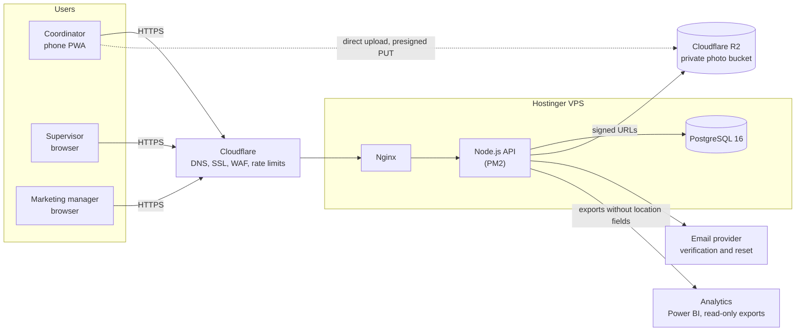

---

## 2. Modules and how they interact

The application is one deployable service, split into modules. Modules call each other only through their service interfaces (section 16.2).

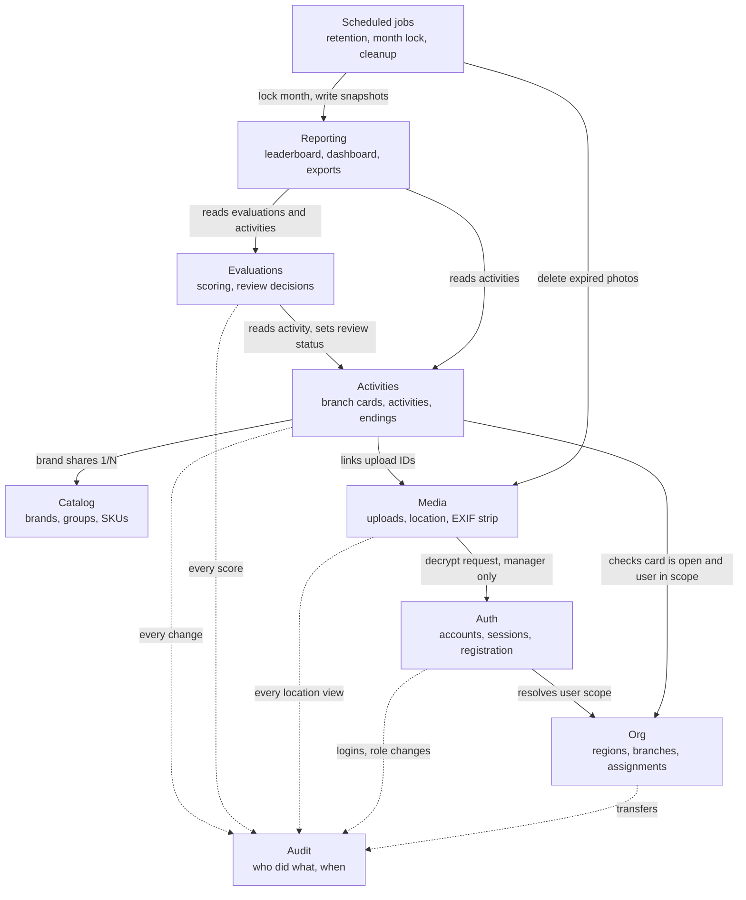

Solid arrows are direct service calls. Dotted arrows are audit writes.

---

## 3. Module ownership of database tables

Each module writes only to its own tables. Other modules read through the owning service.

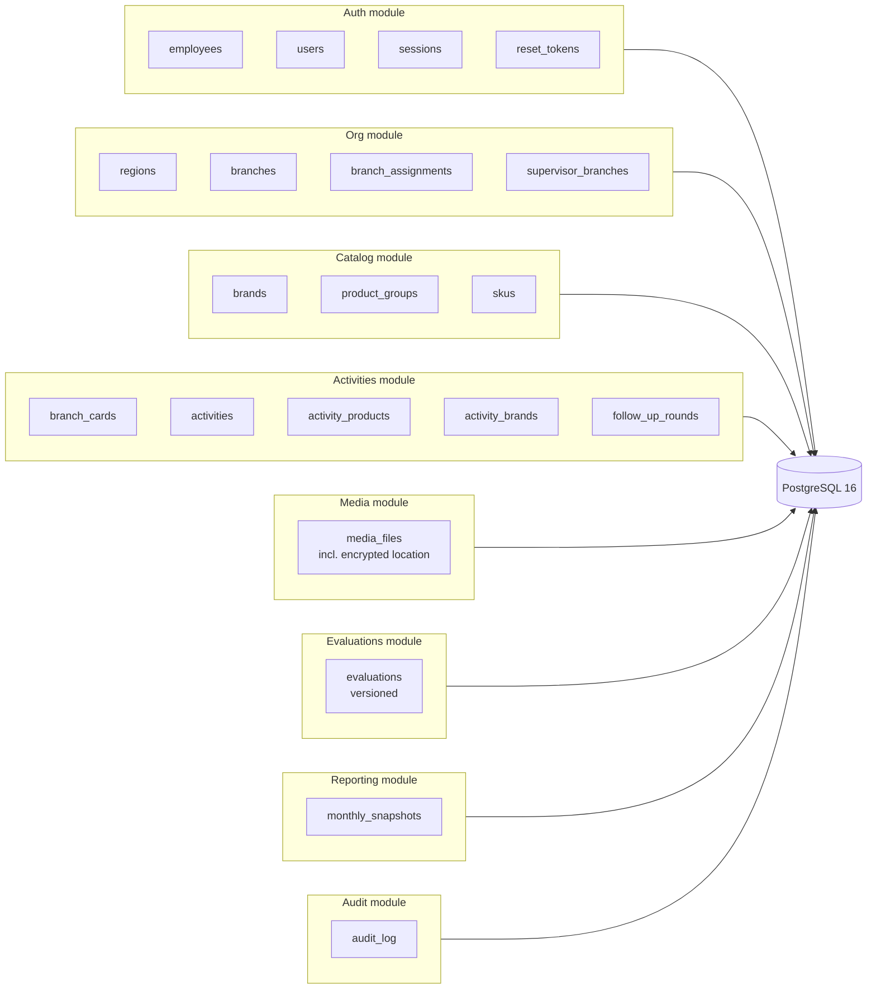

Rule: reporting reads evaluations and activities but never writes to them, and the reporting database role cannot select `capture_location_enc` (section 18).

---

## 4. Database entity relationships

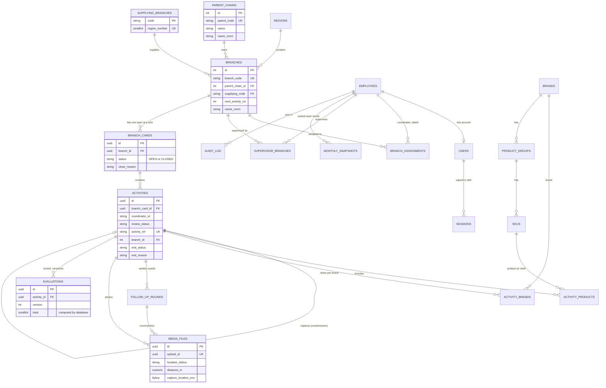

Notes:
- `branch_cards` has a partial unique index: one `OPEN` card per branch (D21).
- `media_files.capture_location_enc` is encrypted. Its row and object are deleted 30 days after the activity ends (D11).
- `evaluations` is append-only. A new version is inserted for each re-score.

---

## 5. End-to-end workflow

From opening a branch card to monthly ranking.

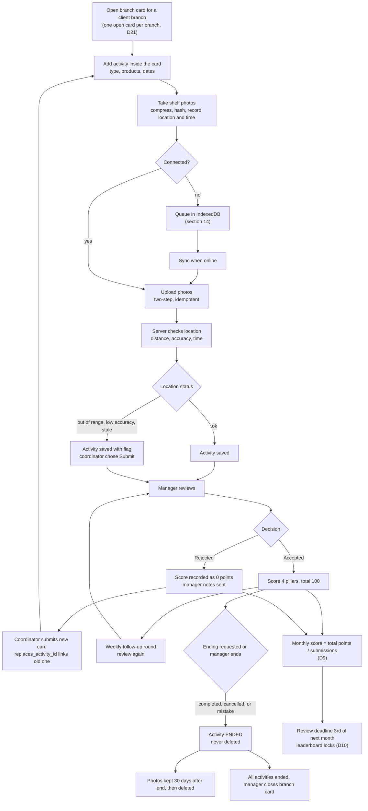

---

## 6. Branch card and activity states

### 6.1 Branch card

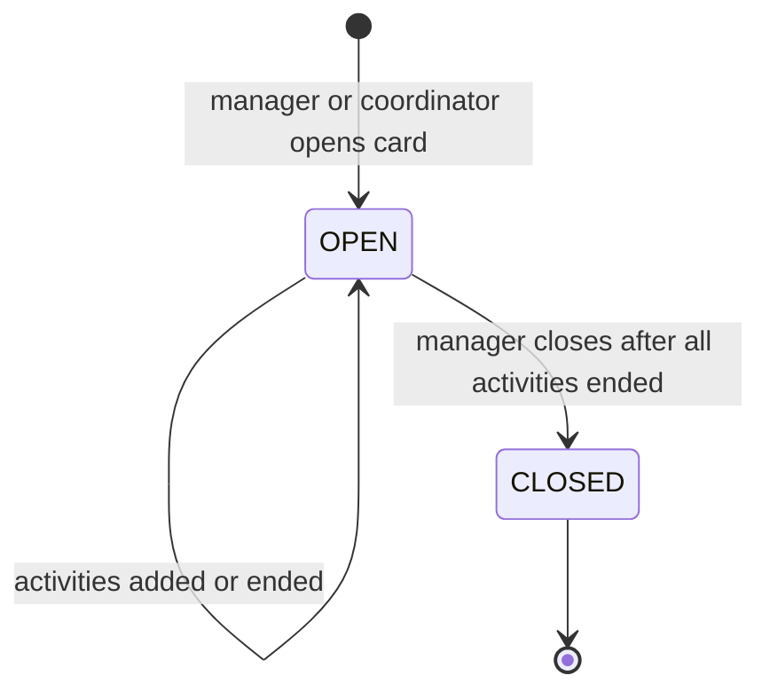

### 6.2 Activity review status and ending status

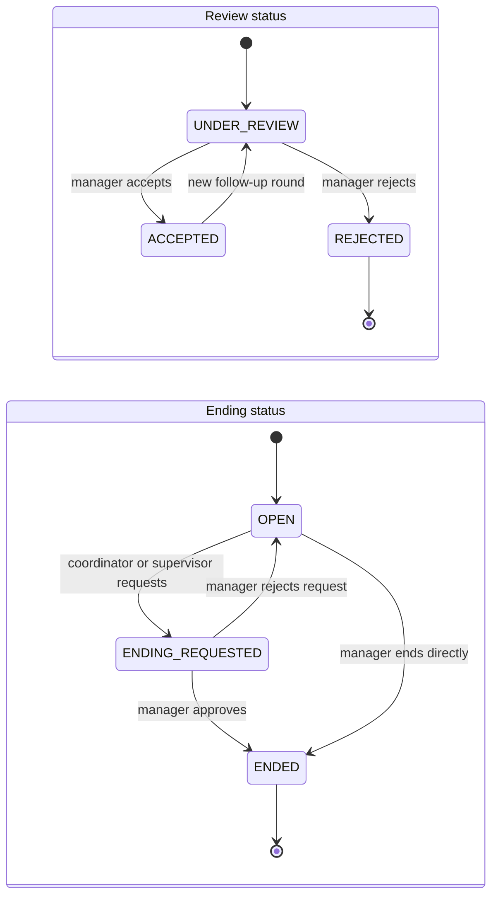

Rules that the diagram enforces:
- `ENDED` is terminal. An ended card is read-only.
- A rejected activity is not edited. The coordinator creates a new card that references it.
- A card is never deleted. Its end reason is `completed`, `cancelled`, or `added_by_mistake`.

---

## 7. Sequence: coordinator creates an activity with photos

Online path. Offline behavior is in section 8.

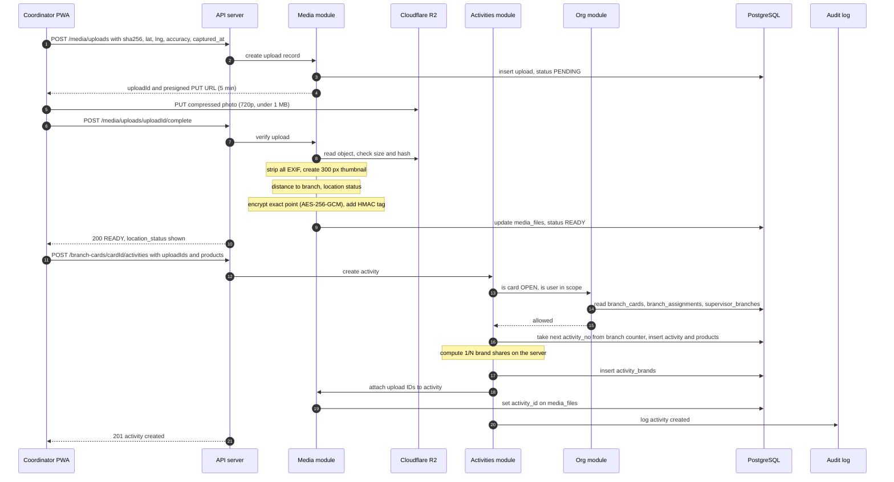

---

## 8. Sequence: offline upload and sync

Photos taken without signal are kept in IndexedDB and sent when the phone reconnects.

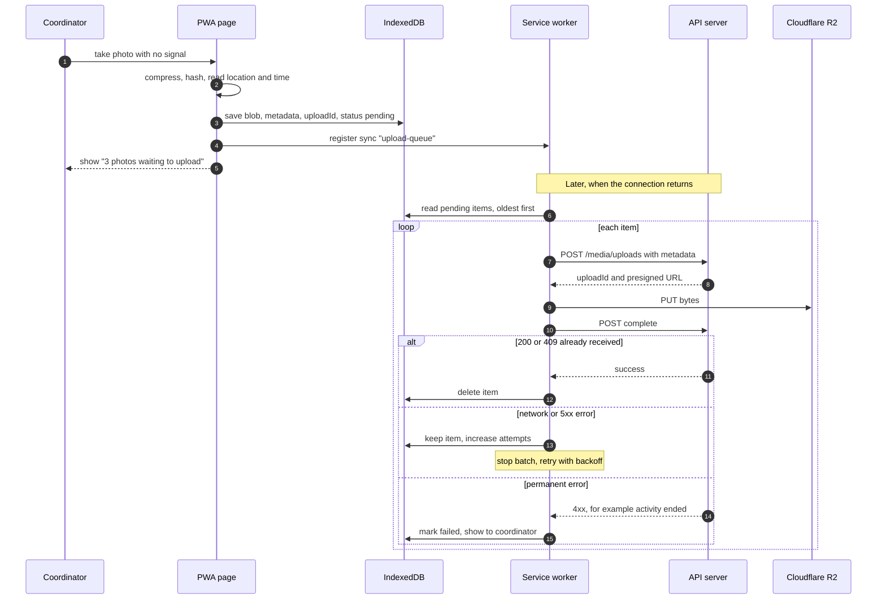

Triggers that start the sync: the `sync` event (Android), the `online` event (iPhone, only while the app is open), and app start.

Late photos: if the capture time is more than 10 minutes before receipt, the server sets `stale`. Photos older than 72 hours are rejected with a recapture message (section 14.4).

---

## 9. Sequence: manager reviews and scores

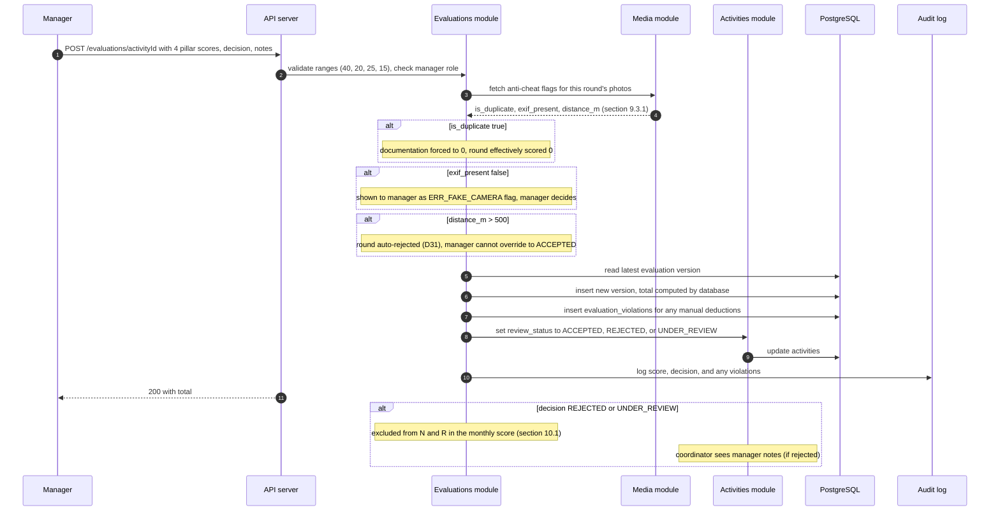

---

## 10. Flow: monthly score and leaderboard lock (Bayesian engine, D27)

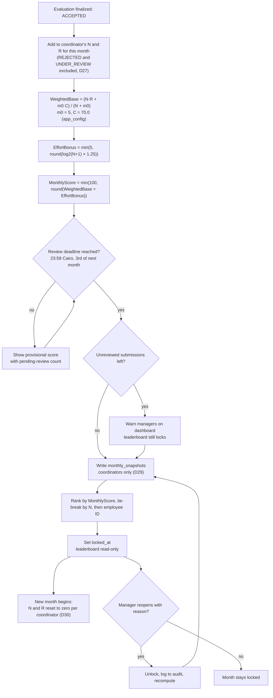

Supervisors and marketing managers are never written to `monthly_snapshots` and never appear on the leaderboard (D29), even though they can still be the ones scoring activities.

---

## 11. Sequence: manager opens a location (audited)

Only managers can decrypt the exact upload point (D13). The audit entry is written before the response is sent.

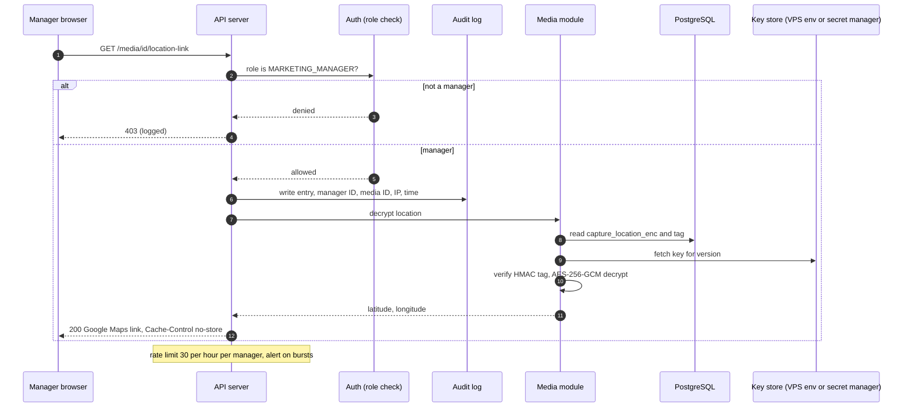

---

## 12. Sequence: registration and login

Registration is allowlisted (D1). The role comes from the employee record, never from the request.

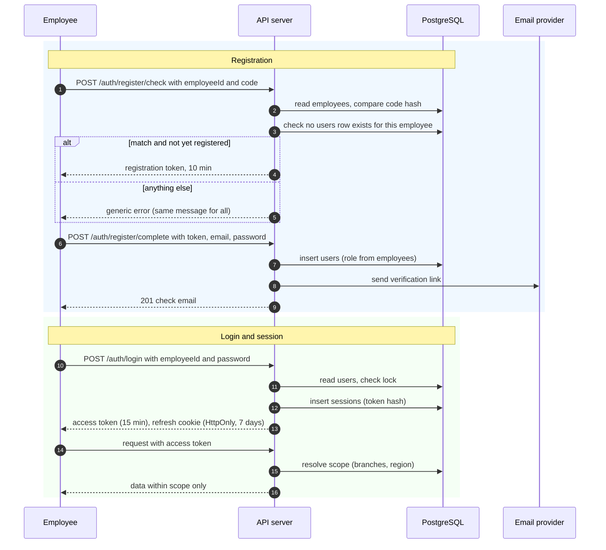

---

## 13. Flow: daily retention job

Runs once per day. Deletes photos 30 days after their activity ends (D11), and never while an activity is open or under dispute.

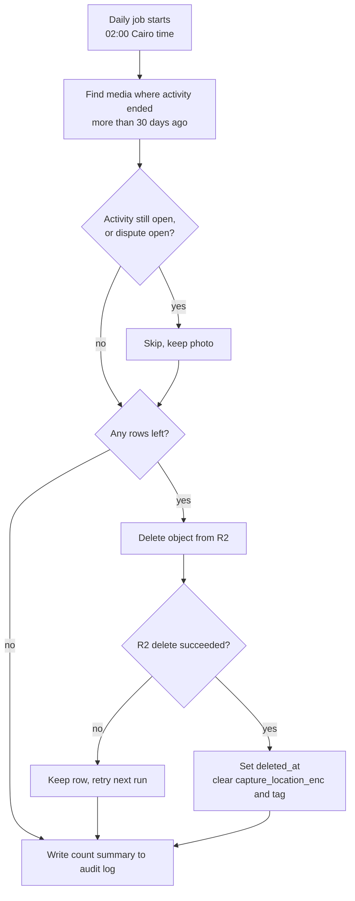

The activity card, distance, accuracy, status, products, shares, ending record, and evaluations are kept. Only photos and encrypted location are removed.

---

## 14. Code generation and lookup

How the activity reference and the employee ADCO code are issued. Both use a locked counter so two requests can't receive the same number.

```mermaid
flowchart TD
    subgraph ACT["Activity reference (per-branch counter, section 8.6)"]
        A1["Create activity in open card"] --> A2["BEGIN transaction"]
        A2 --> A3["UPDATE branches: next_activity_no + 1<br/>(row lock)"]
        A3 --> A4{"activity_no between 1 and 999?"}
        A4 -- no --> A5["Reject: branch counter full<br/>alert administrator"]
        A4 -- yes --> A6["Read parent_code and branch_code"]
        A6 --> A7["Build PARENT/BRANCH/Annn"]
        A7 --> A8["INSERT activity<br/>unique index on activity_ref"]
        A8 --> A9["COMMIT and return reference"]
    end
    subgraph EMP["ADCO employee code (per role and region, section 5.4)"]
        E1["Admin creates employee"] --> E2["BEGIN transaction"]
        E2 --> E3["Increment last_seq for role and region<br/>(row lock)"]
        E3 --> E4{"last_seq between 1 and 99?"}
        E4 -- no --> E5["Block: 99 reached<br/>administrator changes format"]
        E4 -- yes --> E6["Build ADCO-RRSSS"]
        E6 --> E7["INSERT employee<br/>unique index on adco_code"]
        E7 --> E8["COMMIT"]
    end
```

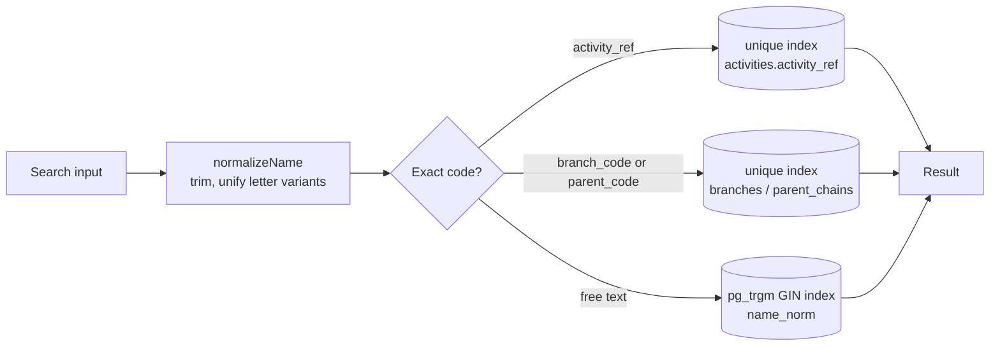

## Maintenance

When the specification changes, update the matching diagram here in the same change. The diagrams should not describe behavior that the specification does not allow.
