# ADCO Platform: System Diagrams

> Companion to **ADCO-System-Specification.md** (v3.0). Section references (for example "D11" or "8.5") point to that file.
> All diagrams use [Mermaid](https://mermaid.js.org). They render on GitHub, GitLab, and in VS Code with a Mermaid extension. To export an image, paste a diagram into https://mermaid.live.

## Contents

1. System context
2. Modules and how they interact
3. Module ownership of database tables
4. Database entity relationships
5. End-to-end workflow
6. Branch card and activity states
7. Sequence: coordinator creates an activity with photos
8. Sequence: offline upload and sync
9. Sequence: manager reviews and scores
10. Flow: monthly score and leaderboard lock
11. Sequence: manager opens a location (audited)
12. Sequence: registration and login
13. Flow: daily retention job

---

## 1. System context

Who uses the system, and which external services it depends on.

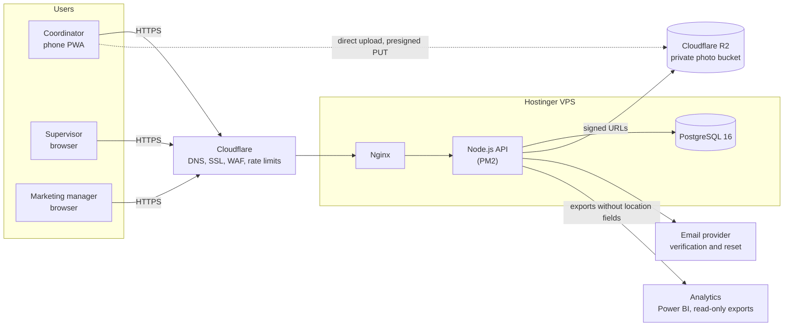

---

## 2. Modules and how they interact

The application is one deployable service, split into modules. Modules call each other only through their service interfaces (section 16.2).

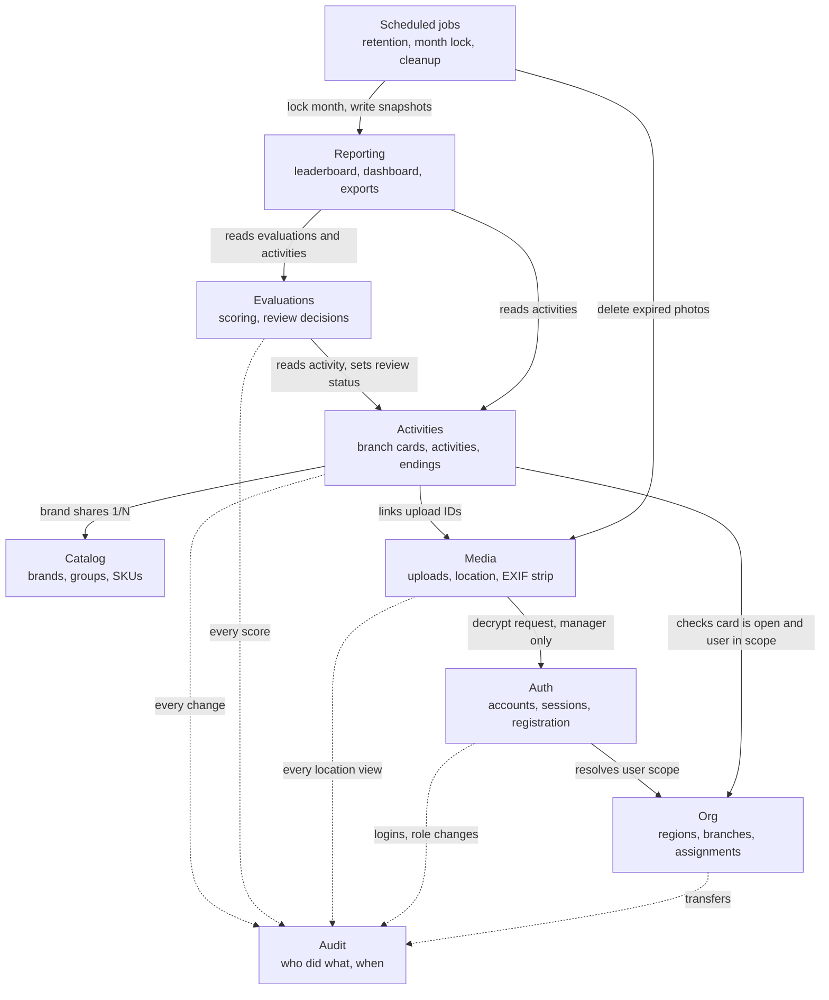

Solid arrows are direct service calls. Dotted arrows are audit writes.

---

## 3. Module ownership of database tables

Each module writes only to its own tables. Other modules read through the owning service.

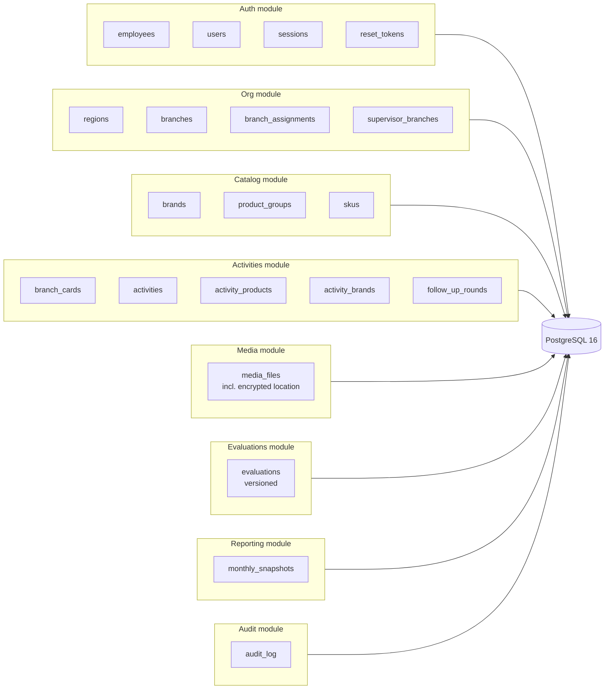

Rule: reporting reads evaluations and activities but never writes to them, and the reporting database role cannot select `capture_location_enc` (section 18).

---

## 4. Database entity relationships

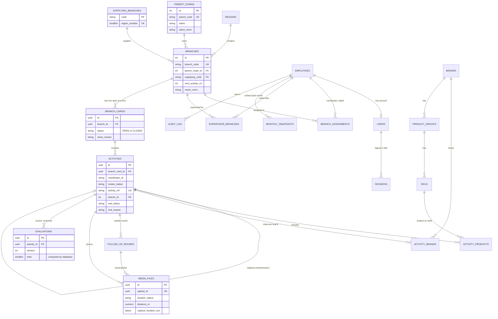

Notes:
- `branch_cards` has a partial unique index: one `OPEN` card per branch (D21).
- `media_files.capture_location_enc` is encrypted. Its row and object are deleted 30 days after the activity ends (D11).
- `evaluations` is append-only. A new version is inserted for each re-score.

---

## 5. End-to-end workflow

From opening a branch card to monthly ranking.

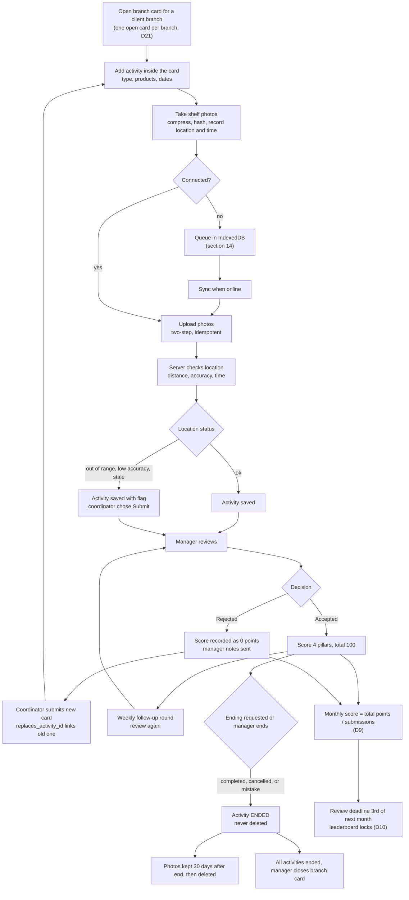

---

## 6. Branch card and activity states

### 6.1 Branch card

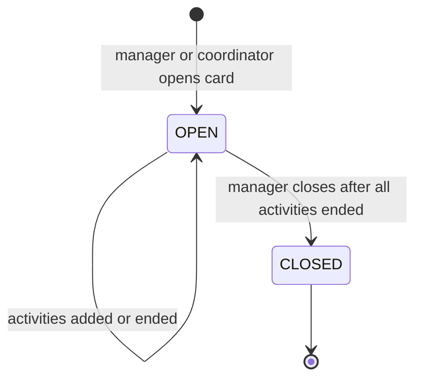

### 6.2 Activity review status and ending status

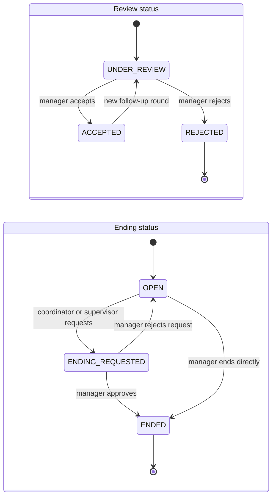

Rules that the diagram enforces:
- `ENDED` is terminal. An ended card is read-only.
- A rejected activity is not edited. The coordinator creates a new card that references it.
- A card is never deleted. Its end reason is `completed`, `cancelled`, or `added_by_mistake`.

---

## 7. Sequence: coordinator creates an activity with photos

Online path. Offline behavior is in section 8.

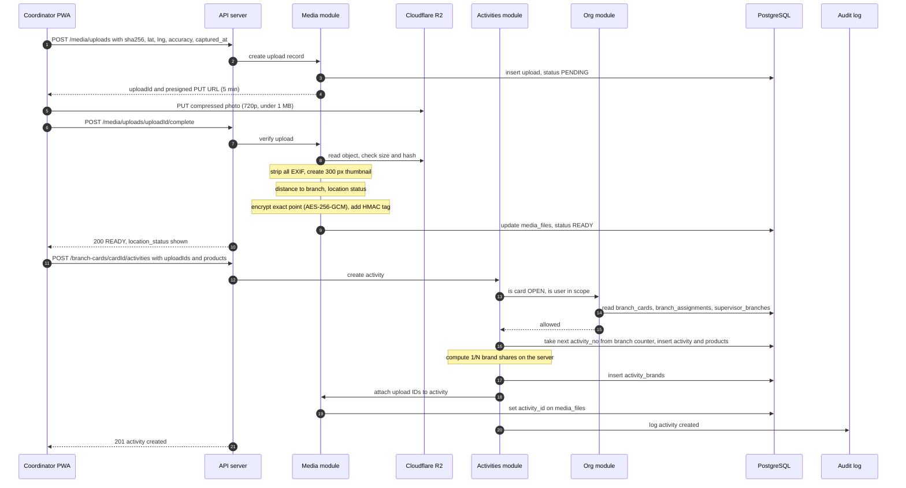

---

## 8. Sequence: offline upload and sync

Photos taken without signal are kept in IndexedDB and sent when the phone reconnects.

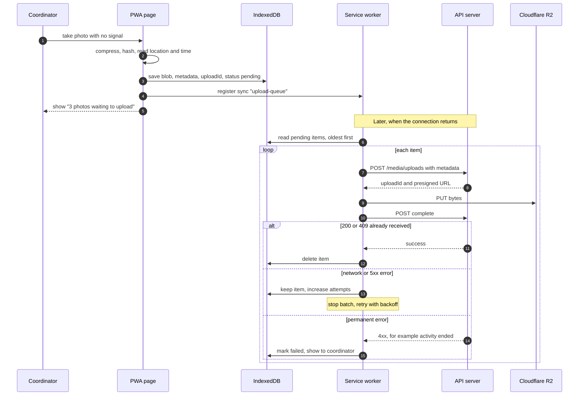

Triggers that start the sync: the `sync` event (Android), the `online` event (iPhone, only while the app is open), and app start.

Late photos: if the capture time is more than 10 minutes before receipt, the server sets `stale`. Photos older than 72 hours are rejected with a recapture message (section 14.4).

---

## 9. Sequence: manager reviews and scores

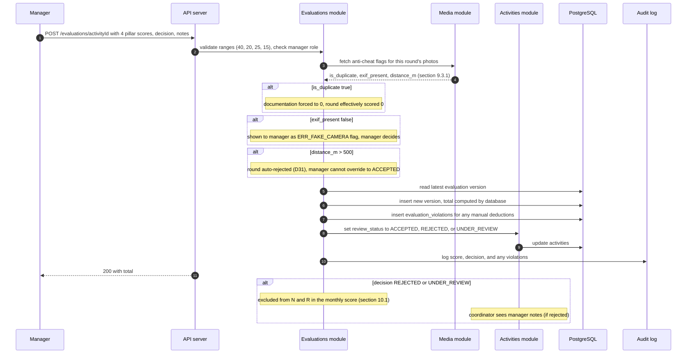

---

## 10. Flow: monthly score and leaderboard lock (Bayesian engine, D27)

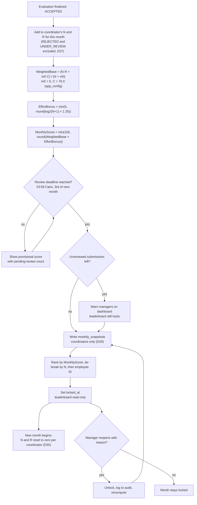

Supervisors and marketing managers are never written to `monthly_snapshots` and never appear on the leaderboard (D29), even though they can still be the ones scoring activities.

Tie-breaks: unrounded score, then number of accepted activities, then employee ID.

---

## 11. Sequence: manager opens a location (audited)

Only managers can decrypt the exact upload point (D13). The audit entry is written before the response is sent.

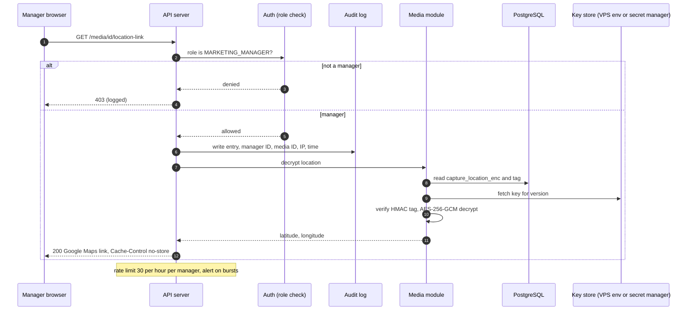

---

## 12. Sequence: registration and login

Registration is allowlisted (D1). The role comes from the employee record, never from the request.

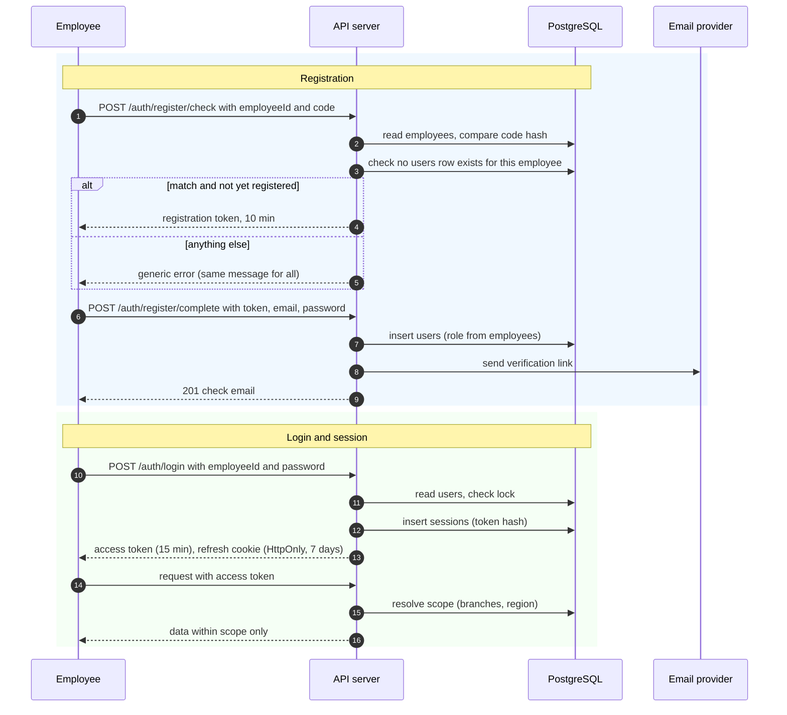

---

## 13. Flow: daily retention job

Runs once per day. Deletes photos 30 days after their activity ends (D11), and never while an activity is open or under dispute.

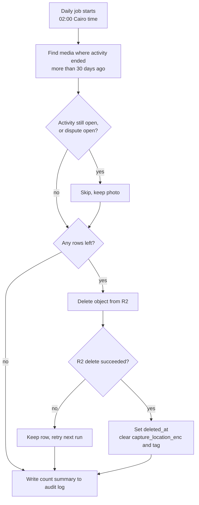

The activity card, distance, accuracy, status, products, shares, ending record, and evaluations are kept. Only photos and encrypted location are removed.

---

## 14. Code generation and lookup

How the activity reference and the employee ADCO code are issued. Both use a locked counter so two requests can't receive the same number.

```mermaid
flowchart TD
    subgraph ACT["Activity reference (per-branch counter, section 8.6)"]
        A1["Create activity in open card"] --> A2["BEGIN transaction"]
        A2 --> A3["UPDATE branches: next_activity_no + 1<br/>(row lock)"]
        A3 --> A4{"activity_no between 1 and 999?"}
        A4 -- no --> A5["Reject: branch counter full<br/>alert administrator"]
        A4 -- yes --> A6["Read parent_code and branch_code"]
        A6 --> A7["Build PARENT/BRANCH/Annn"]
        A7 --> A8["INSERT activity<br/>unique index on activity_ref"]
        A8 --> A9["COMMIT and return reference"]
    end
    subgraph EMP["ADCO employee code (per role and region, section 5.4)"]
        E1["Admin creates employee"] --> E2["BEGIN transaction"]
        E2 --> E3["Increment last_seq for role and region<br/>(row lock)"]
        E3 --> E4{"last_seq between 1 and 99?"}
        E4 -- no --> E5["Block: 99 reached<br/>administrator changes format"]
        E4 -- yes --> E6["Build ADCO-RRSSS"]
        E6 --> E7["INSERT employee<br/>unique index on adco_code"]
        E7 --> E8["COMMIT"]
    end
```

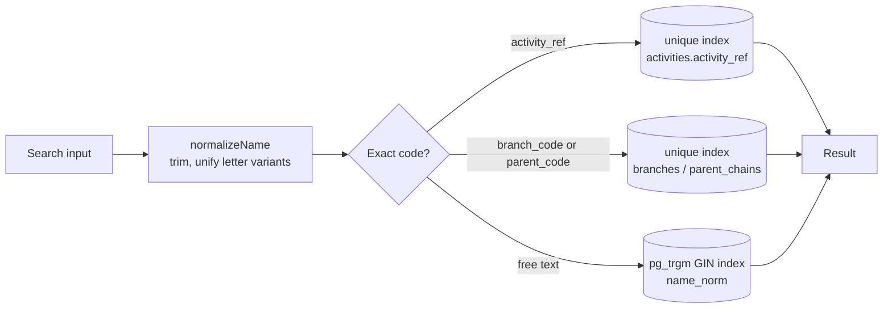

## Maintenance

When the specification changes, update the matching diagram here in the same change. The diagrams should not describe behavior that the specification does not allow.
