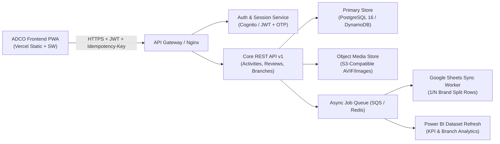

# ADCO Field Operations Platform — Backend Architecture

> **Architecture Standard:** Node.js / TypeScript RESTful API v1 + PostgreSQL 16 + Redis + S3-Compatible Media Store  
> **Cloud & Sync Pipelines:** AWS Cognito / JWT Auth, Lambda / Worker Queues (SQS), DynamoDB / PostgreSQL Store, Google Sheets & Power BI Sync  
> **Company:** (ADCO) شركة الإسكندرية للكيماويات والمنظفات  
> **Timezone Requirement:** Strictly `Africa/Cairo` (UTC+2)

---

## 1. Overview & Architectural Goals

The ADCO backend powers field marketing, merchandising, and retail promotion operations across Egypt with:
1. **3-Tier Role-Based Access Control (RBAC):**
   - `coordinator` (Tier 1): Scoped strictly to their assigned retail branch.
   - `coordinator_supervisor` (Tier 2): Scoped across all branches of their assigned retail client in their region.
   - `marketing_manager` (Tier 3): Unrestricted nationwide administrative, evaluation, export, and analytics access.
2. **Idempotent State Transitions:** All mutating requests (`POST`, `PUT`, `PATCH`) enforce `Idempotency-Key` (UUIDv4) to support reliable offline PWA queue replays.
3. **Field Media & Integrity Pipeline:**
   - Client-side 720p `.avif` / Web-optimized image ingestion with EXIF/camera capture metadata.
   - SHA-256 byte-hash deduplication to reject recycled photos.
   - Haversine GPS proximity verification ($d \le 150\text{ m}$).
4. **Evaluation & Analytics Pipelines:**
   - 100-point 4-pillar scoring matrix ($40/20/25/15$) + Bayesian volume-weighted leaderboard rankings (see [evaluation.md](./evaluation.md)).
   - $1/N$ multi-brand row multiplication for Google Sheets & Power BI sync (`report-export.service.js`).

---

## 2. Cloud & Data Synchronization Architecture

---

## 3. Frontend-to-Backend Integration Boundary

The frontend isolates all transport details behind `frontend/js/api/` and `frontend/js/services/`:
- [`frontend/js/api/client.js`](../../frontend/js/api/client.js) & [`frontend/js/api/http-client.js`](../../frontend/js/api/http-client.js): Centralize base URLs, `Authorization: Bearer <token>`, `Idempotency-Key`, and retry/offline queue handling.
- [`frontend/js/api/endpoints.js`](../../frontend/js/api/endpoints.js): Canonical endpoint constants matching [api-contracts.md](./api-contracts.md).
- `frontend/js/services/*.js`: Pure business orchestration with zero DOM coupling.

---

## 4. Related Backend Documentation

- [API Contracts & REST Endpoints](./api-contracts.md)
- [100-Point Evaluation & Bayesian Leaderboard](./evaluation.md)
- [Complete Final System Design (v3.0)](./system-design.md)
- [System & Sequence Diagrams](./system-diagrams.md)
- [Backend File Structure](./file-structure.md)
- [Backend Guardrails](./guardrails.md)

