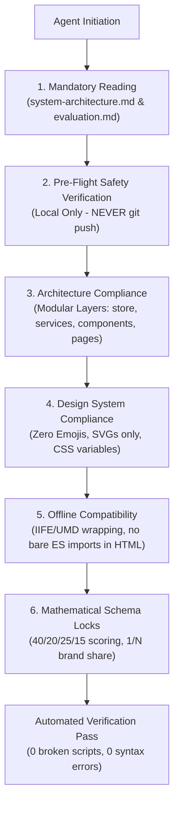

# ADCO Platform — AI Agent & Developer Guardrails

> **Document Version:** 1.0.0  
> **Target Audience:** Autonomous AI Agents, Coding Copilots, and Core Maintainers  
> **Scope:** Architectural Compliance, Safety Rules, Design Integrity, and Git Restrictions  
> **Enforcement Level:** **MANDATORY & ZERO-TOLERANCE**

---

## 1. Executive Summary & Core Directives

This document defines the permanent engineering guardrails and architectural principles governing all modifications to the **Alexandria Company for Chemicals and Detergents (ADCO) Field Operations & Promotion Verification Platform**. 

Every autonomous agent or developer contributing to this repository **must strictly observe** the guardrails below. Defeating, bypassing, or regressing these rules is strictly prohibited.



---

## 2. Rule 1: Mandatory Prerequisite Reading ("Read Before Thinking")

Before writing code, proposing refactorings, or editing files:

1. **You MUST thoroughly read [`docs/system-architecture.md`](./system-architecture.md)** to understand the 3-tier Role-Based Access Control (RBAC), data flow pipelines, relational models, and offline caching strategy.
2. **You MUST thoroughly read [`docs/evaluation.md`](./evaluation.md)** before touching any scoring, rating, review log, or leaderboard calculation logic.
3. **Do NOT guess, hypothesize, or invent architectural patterns** that deviate from the established specifications. When in doubt, consult the documentation index in [`docs/file-structure.md`](./file-structure.md).

---

## 3. Rule 2: Strict Git & Repository Boundaries

1. **NEVER execute `git push`** unless explicitly and unmistakably instructed by the user in the active turn.
2. Keep all commits and modifications strictly local, tested, and verified before concluding any task.
3. Maintain clean, descriptive commit messages documenting the exact changes made.

---

## 4. Rule 3: Zero Emojis Policy (Corporate Aesthetic Standard)

The ADCO enterprise design system requires a clean, professional, high-density corporate visual identity.

1. **Absolute Prohibition of Unicode Text Emojis:**
   - Never inject emojis (such as 📸, 🏆, ⭐, 📍, 📝, 🚀, ⏳, ✅, ❌, etc.) into HTML templates, JavaScript components, button labels, toast messages, modal dialogs, or mock datasets.
2. **Standardized Vector SVG Icons Only:**
   - Use clean, accessible SVG icons sourced from `frontend/assets/icons/` (e.g., `camera.svg`, `star.svg`, `map-pin.svg`, `clipboard-edit.svg`, `check-circle.svg`, `award.svg`).
   - Standardize icon sizing using the design system classes: `.ui-icon-xs` ($14\text{px}$), `.ui-icon-sm` ($16\text{px}$), `.ui-icon` ($18\text{px}$), or `.ui-icon-lg` ($22\text{px}$).

---

## 5. Rule 4: Modular Architecture & Layer Separation

All source code is strictly decoupled into distinct functional layers. Never crowd code or mix architectural responsibilities:

| Directory | Layer Responsibility | Architectural Rules |
|:---|:---|:---|
| `frontend/js/store/` | Reactive State & Storage | Single source of truth for in-memory state, event subscriptions, and persistence (`localStorage`). No DOM rendering logic allowed. |
| `frontend/js/services/` | Business & Domain Logic | Domain operations (activities, branches, auth, GPS). Handles async mock/API calls and data normalization. |
| `frontend/js/utils/` | Pure Utilities | Stateless helper functions (date formatting, currency formatting, score calculation, Haversine distance, EXIF parser). Must be 100% deterministic. |
| `frontend/js/components/` | Reusable UI Templates | Pure HTML/DOM generation functions (cards, modals, badges, table rows). Never manage global state directly. |
| `frontend/js/pages/` | Page Controllers | Dedicated controller per HTML view (1:1 mapping). Initializes DOM, binds event listeners, interacts with services, and renders components. |
| `frontend/css/` | Decoupled Stylesheets | Zero `<style>` tags or inline styles in HTML files. All visual design tokens must be loaded from `frontend/css/variables.css` and dedicated modular stylesheets. |

---

## 6. Rule 5: Universal Script Compatibility (Local `file://` Protocol Support)

The ADCO platform is designed for rapid offline and local deployment without requiring a Node.js bundler, Webpack, or live dev server. Users launch the platform directly via `run-app.bat` or by opening `frontend/index.html` in their web browser.

1. **No Bare Top-Level ES Module Imports in Standard Scripts:**
   - HTML `<script>` tags load classic scripts in global sequence.
   - Never write naked `import ... from ...` or `export default ...` in files included via regular `<script src="...">` tags, as this causes browser fatal errors (`Cannot use import statement outside a module`).
2. **Universal IIFE / UMD Packaging:**
   - All shared utility, service, and component files must be wrapped in standard self-executing closures (IIFE) that attach safely to `window` (or `global` in Node environments) while maintaining CommonJS compatibility for unit tests:
   ```javascript
   (function (global) {
     'use strict';

     const MyModule = {
       doSomething: function () { /* ... */ }
     };

     if (typeof module !== 'undefined' && module.exports) {
       module.exports = MyModule;
     } else {
       global.MyModule = MyModule;
     }
   })(typeof window !== 'undefined' ? window : global);
   ```

---

## 7. Rule 6: Mathematical Schema Locks & Evaluation Formula Integrity

The ADCO operational engine relies on certified mathematical and domain formulas that must never be altered or regressed:

### 1. 100-Point Per-Round Evaluation Matrix
Every review round is scored across exactly 4 weighted pillars totaling 100 points:

$$\text{Total Score} = S_{\text{new}} + S_{\text{quality}} + S_{\text{continuity}} + S_{\text{docs}}$$

| Evaluation Pillar | Arabic Name | Max Points | Form Field ID |
|:---|:---|:---:|:---|
| **Pillar 1: Approved New Activity Value** | الأنشطة الجديدة المعتمدة | **40 pts** | `#eval-score-new-act` |
| **Pillar 2: Execution Quality** | جودة التنفيذ والعرض | **20 pts** | `#eval-score-quality` |
| **Pillar 3: Verified Continuity** | مدة الاستمرارية المثبتة | **25 pts** | `#eval-score-continuity` |
| **Pillar 4: Documentation & Data Integrity** | الالتزام بالتوثيق وصحة البيانات | **15 pts** | `#eval-score-docs` |
| **Grand Total** | إجمالي التقييم | **100 pts** | `#eval-score-total` |

### 2. Multi-Brand $1/N$ Proportional Visibility Weighting
When an activity features $N$ participating brands, each brand receives an identical mathematical visibility share:

$$\text{Brand Share} = \frac{1}{N}, \quad \sum_{i=1}^{N} \text{Share}_i = 1.00 \ (100\%)$$

- Coordinator views hide brand share percentages to minimize cognitive load.
- Marketing Manager views and spreadsheet reports calculate and expose exact $1/N$ shares.

### 3. Supplying Branch Privacy & Data Boundaries
- **Outer / External Cards:** The supplying branch (`فرع الشركة المورد للبضاعة`) must **NEVER** be displayed on outer summary cards (`master-branch-card.js`, `activity-card-item.js`, or `supervisor-panel.html` activity grids).
- **Internal Detail Views Only:** The supplying branch is strictly rendered inside full detail views (`activity-details.html`, `branch-details.html`) and inside the supervisor evaluation modal.

### 4. Location & Anti-Cheat Cutoffs
- **GPS Distance Cutoff:** Maximum allowed discrepancy between user device coordinates and branch coordinates is **$150\text{ meters}$** (computed via Haversine formula in `frontend/js/utils/geo.js`).
- **Timestamp Validation:** EXIF metadata and device submission time are validated against Cairo Standard Time (`Africa/Cairo`, UTC+2).

---

## 8. Automated Pre-Commit Verification Checklist

Before reporting completion of any task to the user, the agent must run the following verification sequence:

- [ ] **Audit Workspace Links:** Run `node scratch/audit_workspace.js` to ensure 0 broken script/stylesheet links across all 12 HTML pages.
- [ ] **Syntax Validation:** Execute `node -c <file>` on all modified JavaScript files to confirm zero syntax errors.
- [ ] **No Naked ES Imports:** Ensure all newly authored or modified browser scripts are wrapped in UMD/IIFE.
- [ ] **Zero Emojis Check:** Search for Unicode emoji code points across all modified files.
- [ ] **Local Verification:** Do not push to remote git repository.
