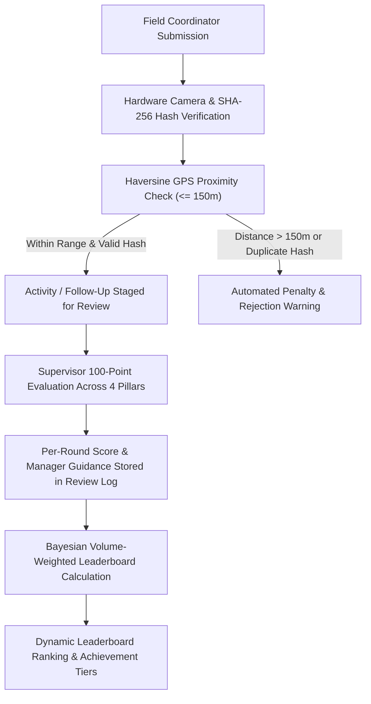

# ADCO 100-Point Field Evaluation & Bayesian Leaderboard Scoring Engine

> **Document ID:** ADCO-ENG-SPEC-005  
> **Company:** (ADCO) شركة الإسكندرية للكيماويات والمنظفات  
> **Module:** Evaluation & Fair Ranking Engine  
> **Version:** 2.5.0  
> **Status:** Production Standard  

---

## 1. Executive Summary & Purpose

The Alexandria Company for Chemicals and Detergents (ADCO) operates field marketing, merchandising, and retail promotion campaigns across hundreds of hypermarket and supermarket branches nationwide (such as Fathalla Market, Carrefour, Zahran, Gomla Market, and Metro).

To ensure objective grading, incentivize field consistency, eliminate fraudulent submissions, and fairly rank coordinators across branches of varying sizes, the ADCO platform implements a dual-layer evaluation architecture:
1. **Per-Round 100-Point Scoring Matrix:** An objective, 4-pillar grading framework applied by Marketing Managers and Supervisors to every initial activity and sequential follow-up round.
2. **Automated Deduction & Anti-Cheat Gateways:** Hardware-enforced camera checks, SHA-256 byte hashing, and Haversine GPS proximity radius verification ($d \le 150\text{ m}$) preventing duplicate or off-site submissions.
3. **Bayesian Volume-Weighted Leaderboard Algorithm:** A statistical formula balancing average score with verified volume and effort, preventing a coordinator with a single high-scoring submission from outranking a diligent coordinator with dozens of verified multi-round activities.



---

## 2. 100-Point Per-Round Evaluation Breakdown

Every activity card and sequential follow-up round in the Review Log (`سجل المراجعات`) is evaluated on an exact 100-point scale partitioned across four strategic pillars:

| Pillar | Arabic Title | Max Points | Weight | Primary Measurement Standard |
|:---|:---|:---:|:---:|:---|
| **Pillar 1** | الأنشطة الجديدة المعتمدة | **40** | 40% | Display medium scale, contract compliance, and branch coverage |
| **Pillar 2** | جودة التنفيذ والعرض الميداني | **20** | 20% | Vertical brand blocking, shelf cleanliness, visibility, and pricing tags |
| **Pillar 3** | مدة الاستمرارية المثبتة | **25** | 25% | Multi-round replenishment, display persistence, and preventing OOS gaps |
| **Pillar 4** | الالتزام بالتوثيق وصحة البيانات | **15** | 15% | Live hardware camera capture, GPS proximity match ($d \le 150\text{ m}$), and SKU accuracy ($1/N$ share) |
| **Total** | **التقييم الشامل المعتمد** | **100** | **100%** | **Official Round Score** |

```
+---------------------------------------------------------------------------------------+
|                       ADCO 100-POINT EVALUATION SCORECARD                            |
+---------------------------+---------------------------+---------------+---------------+
|  1. New Activity (40 pts) |  2. Quality (20 pts)      | 3. Cont. (25) | 4. Doc. (15)  |
|  - Podium / Island: 35-40 |  - Shelf Planogram: 0-8   | - 3+ Rounds   | - Live Cam: 5 |
|  - Gondola Head:   28-34  |  - Facing & Labels: 0-6   |   Verified:25 | - GPS <=150m:5|
|  - Floor Stand:    20-27  |  - Cleanliness/POP: 0-6   | - 2 Rounds:20 | - SKU Match: 5|
+---------------------------+---------------------------+---------------+---------------+
```

---

### Pillar 1: Approved New Activity Value (`الأنشطة الجديدة المعتمدة` — 40 Points Max)
Evaluates the execution scale, strategic impact of the display medium, and promotional agreement compliance:

- **Tier 1 — High-Impact Mega Displays (35 – 40 Points):**
  - Magazine Spread Feature (`فرشة مجلة`).
  - Central Promotional Podium (`بوديوم مركزي` or `مهرجان بوديوم x 4`).
  - Independent Promotional Island (`جزيرة عرض`).
- **Tier 2 — Prime Feature Displays (28 – 34 Points):**
  - Gondola Head (`رأس جندولة` / `جندولة رئيسية`).
  - Heavy-Duty Floor Display Stand (`فلور ستاند معدني`).
- **Tier 3 — Secondary & Standard Placements (20 – 27 Points):**
  - Endcap Shelf Extender (`جناح أرفف`).
  - Side Hanging Banner / Hanger (`ستاند تعليق`).
  - Standard Shelf Facing (`واجهة أرفف نمطية`).

> [!NOTE]
> If an activity is currently `Under Review` pending initial supervisor approval, it is awarded a default baseline of `25 Points`. If rejected, it receives `0 Points`.

---

### Pillar 2: Execution Quality (`جودة التنفيذ والعرض` — 20 Points Max)
Evaluates the merchandising aesthetics and retail presentation standards of ADCO products (Velveta, Feeya, Diva, Cloril, Maxil Magic, Glaxy):

- **Vertical Brand Blocking (0 – 8 Points):** All ADCO SKUs arranged vertically by brand, creating high-contrast visual blocks on supermarket shelves.
- **Frontline Facing & Alignment (0 – 6 Points):** Product bottles and packages front-faced, fully aligned to the shelf lip, with forward facing labels.
- **Hygiene, POS Materials & Price Tags (0 – 6 Points):** Shelves completely free from dust or detergent leaks; company shelf talkers, promotional wobblers, and official client price tags clearly attached.

> [!TIP]
> If a 10-point supervisor rating scale is submitted in the mobile inspection interface, it is converted to the 20-point quality pillar via the linear transform:
> $$\text{ExecutionQualityScore} = \text{round}\left(\frac{\text{Rating}_{10}}{10} \times 20\right)$$

---

### Pillar 3: Verified Continuity (`مدة الاستمرارية المثبتة` — 25 Points Max)
Rewards display persistence, stock replenishment, and the coordinator's diligence in maintaining product availability over consecutive calendar weeks:

| Verified Rounds Count | Active Campaign Duration | Assigned Continuity Points | Operational Assessment |
|:---|:---|:---:|:---|
| **$\ge 3$ Follow-Up Rounds** | $\ge 30\text{ Days}$ | **25 Points** | Flawless continuity; display maintained and replenished without interruption |
| **2 Follow-Up Rounds** | $14 - 29\text{ Days}$ | **20 Points** | Strong continuity; regular visits and steady stock levels |
| **1 Follow-Up Round** | $7 - 13\text{ Days}$ | **15 Points** | Standard initial follow-up completed |
| **Foundational Setup Only** | $< 7\text{ Days}$ | **10 Points** | Initial setup verified; awaiting subsequent confirmation |

---

### Pillar 4: Documentation & Data Integrity (`الالتزام بالتوثيق وصحة البيانات` — 15 Points Max)
Measures adherence to data authenticity, geolocation accuracy, and product catalog registration:

1. **Live Camera Capture (5 Points):** Photo must be captured directly through the mobile device's live camera pipeline with canvas timestamp watermark. Gallery file uploads or pre-stored photos are strictly disallowed.
2. **GPS Proximity Radius (5 Points):** The coordinator's live GPS coordinates must be within $150\text{ meters}$ of the official registered branch coordinates:
   $$\text{HaversineDistance}(\text{Coord}_{\text{device}}, \text{Coord}_{\text{branch}}) \le 150\text{ m} \implies 5\text{ Points}$$
   If distance $> 150\text{ m}$, `0 / 5` is assigned automatically.
3. **Accurate SKU Selection & $1/N$ Brand Share (5 Points):** All registered ADCO brands and SKU items must exactly match the physical merchandise visible on shelf, allowing correct calculated brand share weights ($1/N$).

---

## 3. Automated Deductions & Anti-Cheat Matrix

The platform incorporates automated guardrails and supervisor-enforced deductions to ensure data integrity:

| Violation Code | Arabic Label | Detection Method | Severity | Point Deduction | System Action |
|:---|:---|:---|:---:|:---:|:---|
| `ERR_PHOTO_DUPLICATE` | صورة مكررة مرتين | SHA-256 byte hash match across rounds or activities | Critical | **0 for Round + -15 Documentation** | Automatic fraud flag; round rejected; alert sent to Marketing Manager |
| `ERR_FAKE_CAMERA` | صورة وهمية أو غير ملتقطة بالكاميرا | Canvas signature, missing EXIF timestamp, or synthetic image | Critical | **0 / 100 (Disqualification)** | Entire activity disqualified; coordinator flagged for audit |
| `ERR_GPS_MISMATCH` | تجاوز النطاق الجغرافي للفرع (>150م) | Haversine distance $> 150\text{ m}$ between device & branch | High | **0 / 15 Documentation** | Distance badge turned red; supervisor notified; rejection if $> 500\text{ m}$ |
| `ERR_POOR_QUALITY` | ضعف جودة الصورة أو صورة مهزوزة | Visual inspection by Supervisor / Manager | Medium | **-5 to -12 Points** | Retake required; detailed note added to review log |
| `ERR_SKU_MISMATCH` | عدم تطابق الأصناف المسجلة مع الصورة | Visual audit of shelf SKUs vs registered items | Medium | **-5 to -10 Documentation** | Immediate recalculation of $1/N$ brand share weights |
| `ERR_NEGLECTED_FOLLOWUP` | إهمال المتابعة الدورية أو فراغ العرض | Follow-up gap $> 14\text{ days}$ or empty shelf facing | High | **-10 to -25 Continuity** | Warning issued; branch manager escalation |

> [!WARNING]
> Duplicate images are identified via cryptographically secure SHA-256 digests computed over the raw compressed canvas bytes before network transmission. Attempting to upload identical photos across distinct follow-up rounds immediately zeroes out the round's score.

---

## 4. Fair Leaderboard Ranking Algorithm (Bayesian Volume-Weighted Model)

### 4.1 The Small Sample Dilemma
In retail field management, standard arithmetic averaging ($\frac{\sum \text{Score}}{N}$) causes an unfair ranking anomaly:
- A coordinator who submits **1 single activity** that scores **95/100** achieves an arithmetic average of `95.0`.
- A diligent coordinator managing 6 branches with **12 approved follow-ups** averaging **92/100** achieves an arithmetic average of `92.0`.
- Under naive averaging, the coordinator with 1 submission unfairly takes Rank #1.

### 4.2 The Bayesian Formula
To resolve this, ADCO employs a **Bayesian Volume-Weighted Rating Model** combined with an **Effort & Consistency Bonus**:

1. **Parameters:**
   - $N$: Total number of approved rounds/activities submitted by the coordinator.
   - $R$: Raw arithmetic average of the coordinator's approved rounds:
     $$R = \frac{1}{N} \sum_{i=1}^{N} \text{Score}_i$$
   - $m$: Confidence threshold parameter (fixed at $m = 5$ benchmark rounds).
   - $C$: Baseline prior average score across the company (fixed at $C = 70.0$).

2. **Bayesian Weighted Base Score:**
   $$\text{WeightedBase} = \frac{(N \times R) + (m \times C)}{N + m}$$

3. **Volume & Effort Bonus ($\text{EffortBonus}$):**
   A progressive logarithmic reward for sustained field productivity (up to $+5\text{ points}$, capped at 100 overall):
   $$\text{EffortBonus} = \min\left(5, \text{round}\left(\log_2(N + 1) \times 1.25\right)\right)$$

4. **Final Official Leaderboard Score:**
   $$\text{FinalLeaderboardScore} = \min\left(100, \text{round}(\text{WeightedBase} + \text{EffortBonus})\right)$$

---

### 4.3 Mathematical Comparison & Proof

The following table demonstrates how the Bayesian engine fairly ranks coordinators across different volume levels:

| Coordinator Name | Role & Scoping | Approved Rounds ($N$) | Raw Avg ($R$) | Bayesian Base | Effort Bonus | Final Score | Official Rank |
|:---|:---|:---:|:---:|:---:|:---:|:---:|:---:|
| **Ayman El-Rouby** | Coordinator Supervisor (Fathalla) | **12** | 92.0 | 85.53 | +5 | **91** | **#1 (Gold)** |
| **Mohamed El-Shennawy** | Coordinator (El-Montazah) | **8** | 89.0 | 81.69 | +4 | **86** | **#2 (Silver)** |
| **Sarah Ibrahim** | Coordinator (West Sector) | **5** | 91.0 | 80.50 | +3 | **84** | **#3 (Bronze)** |
| **Ahmed El-Abd** | Coordinator (Smouha) | **4** | 88.0 | 78.00 | +3 | **81** | **#4** |
| **Noha Abdel Aziz** | Coordinator (Sidi Gaber) | **3** | 84.0 | 75.25 | +3 | **78** | **#5** |
| *Hypothetical New User* | 1 High Score (Single Shot) | **1** | 95.0 | 74.17 | +1 | **75** | **#6** |

```
Bayesian Normalization Impact:
1 submission at 95/100  -----> Normalized to 75/100 (Cannot take 1st place)
12 rounds at 92/100     -----> Normalized to 91/100 (Wins 1st place legitimately)
```

---

### 4.4 Achievement Tier Badges

Final scores map directly to enterprise achievement tiers:

| Score Range | Tier Title (Arabic) | Tier Class | Badge Accent |
|:---|:---|:---|:---|
| **90 – 100** | ممتاز — فئة ماسية | `badge-diamond` | Soft Emerald Glow (`#0f766e`) |
| **80 – 89** | جيد جداً — فئة ذهبية | `badge-gold` | Warm Gold Accent (`#d97706`) |
| **70 – 79** | جيد — فئة فضية | `badge-silver` | Cool Slate Accent (`#64748b`) |
| **60 – 69** | مقبول — فئة برونزية | `badge-bronze` | Warm Bronze Accent (`#b45309`) |
| **< 60** | قيد التحسين والمتابعة | `badge-danger` | Soft Red Alert (`#ef4444`) |

---

## 5. Review Log Data Contract (`سجل المراجعات`)

Each activity object maintains a chronological collection of follow-up inspection rounds inside `followUps[]` (also represented as `followUpHistory[]` in client state).

### JSON Schema Specification:

```json
{
  "$schema": "https://json-schema.org/draft/2020-12/schema",
  "title": "ADCOFollowUpRound",
  "type": "object",
  "required": [
    "roundNumber",
    "roundTitle",
    "timestamp",
    "uploadedBy",
    "uploadedById",
    "reviewStatus",
    "scoreBreakdown",
    "photos",
    "location"
  ],
  "properties": {
    "roundNumber": {
      "type": "integer",
      "minimum": 1,
      "description": "Sequential follow-up round index (1 = Initial Setup, 2+ = Follow-up)"
    },
    "roundTitle": {
      "type": "string",
      "example": "جولة المتابعة 2 — تعزيز الرصيد"
    },
    "timestamp": {
      "type": "string",
      "format": "date-time",
      "description": "ISO 8601 capture timestamp in Africa/Cairo timezone"
    },
    "uploadedBy": {
      "type": "string",
      "example": "أحمد محمود العبد"
    },
    "uploadedById": {
      "type": "string",
      "example": "ADCO-101"
    },
    "reviewStatus": {
      "type": "string",
      "enum": ["Accepted", "Under Review", "Rejected"]
    },
    "sessionScore": {
      "type": ["number", "null"],
      "minimum": 0,
      "maximum": 100,
      "example": 92
    },
    "scoreBreakdown": {
      "type": "object",
      "required": ["newActivity", "executionQuality", "continuity", "documentation", "total"],
      "properties": {
        "newActivity": { "type": "number", "minimum": 0, "maximum": 40 },
        "executionQuality": { "type": "number", "minimum": 0, "maximum": 20 },
        "continuity": { "type": "number", "minimum": 0, "maximum": 25 },
        "documentation": { "type": "number", "minimum": 0, "maximum": 15 },
        "total": { "type": "number", "minimum": 0, "maximum": 100 }
      }
    },
    "managerNote": {
      "type": "string",
      "description": "Marketing manager written feedback and directives for this specific round",
      "example": "تنسيق ممتاز لعبوات فلفيتا وفييا مع الالتزام بالبلوك الرأسي."
    },
    "location": {
      "type": "object",
      "required": ["latitude", "longitude", "accuracy", "distanceMeters", "isWithin150m"],
      "properties": {
        "latitude": { "type": "number" },
        "longitude": { "type": "number" },
        "accuracy": { "type": "number" },
        "distanceMeters": { "type": "number" },
        "isWithin150m": { "type": "boolean" },
        "capturedAt": { "type": "string" }
      }
    },
    "photos": {
      "type": "array",
      "items": {
        "type": "object",
        "required": ["photoUrl", "photoHash", "width", "height", "sizeKb", "liveVerified"],
        "properties": {
          "photoUrl": { "type": "string", "format": "uri" },
          "photoHash": { "type": "string", "pattern": "^[a-f0-9]{64}$" },
          "width": { "type": "integer", "example": 1280 },
          "height": { "type": "integer", "example": 720 },
          "sizeKb": { "type": "number", "maximum": 1024 },
          "liveVerified": { "type": "boolean" },
          "capturedAt": { "type": "string" }
        }
      }
    },
    "brands": {
      "type": "array",
      "items": { "type": "string" },
      "example": ["فلفيتا", "فييا"]
    },
    "products": {
      "type": "array",
      "items": {
        "type": "object",
        "properties": {
          "brand": { "type": "string" },
          "skuItem": { "type": "string" }
        }
      }
    },
    "reviewerName": {
      "type": ["string", "null"],
      "example": "م. حسام الدين غانم"
    },
    "reviewedAt": {
      "type": ["string", "null"],
      "format": "date-time"
    }
  }
}
```

---

## 6. Implementation Reference: `ScoreCalculator` Utility

The specification above is implemented in pure JavaScript at `frontend/js/utils/score-calculator.js`.

### Core Method Signatures:

```javascript
// 1. 100-Point Weighted Evaluation Breakdown
ScoreCalculator.computeWeightedEvaluation(act)
// Returns: { totalWeightedScore, badgeText, badgeTier, breakdown: { newActivity, executionQuality, continuity, documentation } }

// 2. Anti-Cheat & Automated Penalty Verification
ScoreCalculator.checkAntiCheatPenalties(roundData)
// Returns: { isEligible, deductions, finalDocumentationScore, violations: [] }

// 3. Bayesian Volume-Weighted Leaderboard Score
ScoreCalculator.calculateBayesianLeaderboardScore(approvedRoundsCount, rawAverageScore, options)
// Returns: integer [0 - 100]

// 4. Effort & Consistency Bonus
ScoreCalculator.calculateEffortBonus(approvedRoundsCount)
// Returns: integer [0 - 5]
```

---

## 7. Change Log & Architectural Revisions

| Version | Date | Author | Summary of Changes |
|:---|:---|:---|:---|
| `1.0.0` | 2026-10-15 | ADCO Engineering | Initial 100-point 4-pillar evaluation definition. |
| `2.0.0` | 2026-11-01 | ADCO Operations | Added Haversine GPS 150m cutoff and SHA-256 duplicate detection. |
| `2.5.0` | 2026-11-12 | ADCO Core Team | Implemented Bayesian Volume-Weighted Leaderboard formula, multi-round Review Log schema, and aligned `ScoreCalculator` utility. |
