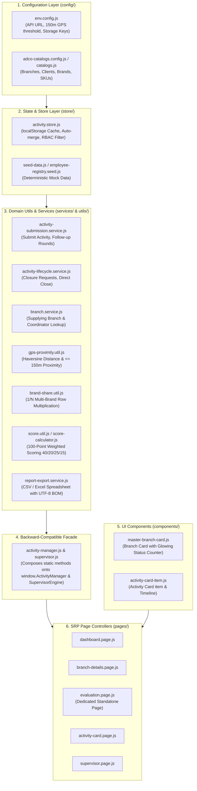
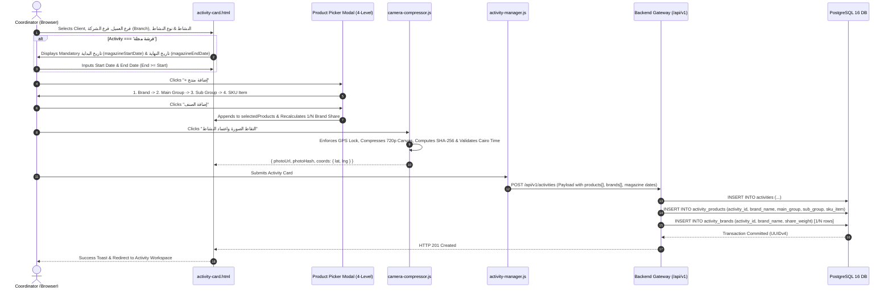

# (ADCO) شركة الاسكندريه للكيماويات و المنظفات — Master Architecture & Data Flow Blueprint

> **System Version:** 2.5.0 Enterprise Modern Web Architecture  
> **Official Corporate Entity:** (ADCO) شركة الاسكندريه للكيماويات و المنظفات  
> **Target Framework:** Clean Modular Vanilla ES Modules & Modern CSS Variables Design System  
> **Backend Integration:** RESTful JSON API v1 / PostgreSQL 16 / S3-Compatible Media Store  
> **Timezone Requirement:** `Africa/Cairo` (UTC+2)  

---

## 1. Clean Repository Map & Architecture Blueprint

```text
adco-field-app/
├── docs/                                          # Master Engineering & Architecture Documentation
│   ├── endpoints.md                               # RESTful API Specifications & DTO Contracts
│   ├── file-structure.md                          # Repository File Inventory & Responsibility Guide
│   ├── system-architecture.md                     # System Architecture, Data Flow & Type Matrix
│   └── ui-ux-design-guide.md                      # UI/UX Specifications, Design Tokens & Style Guide
├── frontend/                                      # Clean Single Source of Truth Client Application
│   ├── index.html                                 # Landing Shell & Session Resume Gate
│   ├── manifest.json                              # PWA Web App Manifest
│   ├── sw.js                                      # Offline Service Worker (Cache First for Static Assets)
│   ├── assets/                                    # Optimized Icons & Graphics
│   ├── css/                                       # 14 Decoupled Modular CSS Files
│   ├── pages/                                     # 8 Semantic Operational HTML Pages
│   └── js/                                        # Modular Hybrid Layer + Feature Architecture
│       ├── config/                                # Centralized Environment, Catalogs & Constant Keys
│       ├── store/                                 # Caching, State Merging & Seed Datasets
│       ├── services/                              # Business Operations, Submissions & Lifecycle Management
│       ├── utils/                                 # Pure Domain Math, GPS Haversine, Image Compression & Formatters
│       ├── components/                            # Reusable Pure HTML Template Renderers & Modals
│       └── pages/                                 # SRP View Controllers (Dashboard, Activity, Evaluation, etc.)
├── run-app.bat                                    # Windows Desktop Local Launcher
├── vercel.json                                    # Cloud Deployment Routing Configuration
└── README.md                                      # Documentation Portal & Quick Start Guide
```

### 1.1 Modular Frontend Architecture & Data Flow (`Store -> Services/Utils -> Components -> Pages`)

The frontend JavaScript codebase enforces a strict **Hybrid Layer + Feature Architecture** designed for high maintainability and testability:



* **Backward-Compatible Facade Pattern:** All decomposing modules register their methods in `window.ADCO_ACTIVITY_MODULES`. The facade (`frontend/js/activity-manager.js`) composes these static methods onto `window.ActivityManager` at initialization time, guaranteeing zero breaking changes for existing call sites while keeping each module under 250–350 lines.
* **Standalone Evaluation View (`evaluation.html` + `evaluation.page.js`):** Decoupled from floating modals/popups into an independent full-screen route (`?id=ACT-...`), featuring permanent F5 refresh persistence and zero text clashing.

---

## 2. Screen-by-Screen Data Inputs & Validation Rules

### 2.1 Authentication: Login (`frontend/pages/login.html`)
* **Header Layout:** Company logo (`ADCO-logo.png`), pill badge (`بوابة العمليات الميدانية المعتمدة`), and main heading (`منظومة ادارة العمليات`) are stacked vertically and centered directly underneath each other (`display: flex; flex-direction: column; align-items: center; text-align: center;`).
* **Inputs:**
  * `employeeId` (Text, trimmed): Required, 3–20 alphanumeric chars (`/^[A-Za-z0-9_-]{3,20}$/`).
  * `password` (Password with show/hide toggle): Required, minimum 6 chars.
  * `rememberMe` (Checkbox): Persists session token in `localStorage` vs. `sessionStorage`.
* **Actions:** Validates credentials via `POST /api/v1/auth/login`. On success, stores JWT `{accessToken, refreshToken, user}` and redirects to `dashboard.html`.

### 2.2 Registration: 3-Step Wizard (`frontend/pages/signup-wizard.html`)
* **Step 1: Identity & Credentials:**
  * `fullName` (Text): 3–100 chars, Arabic or English full name.
  * `employeeId` (Text): 3–20 alphanumeric characters, must be unique.
  * `role` (Select): `coordinator` (منسق ميداني) or `supervisor` (مشرف عمليات).
  * `password` (Password): Min 8 chars, at least 1 uppercase, 1 lowercase, 1 number.
  * `confirmPassword` (Password): Must match `password` identically.
* **Step 2: Contact & Regional Assignment:**
  * `phone` (Tel): Egyptian mobile regex `^01[0125][0-9]{8}$`.
  * `email` (Email): Standard RFC-5322 email regex.
  * `assignedRegion` (Select): Alexandria, Cairo, Giza, Delta, Upper Egypt, Canal.
* **Step 3: Verification & Security Agreement:**
  * `termsAccepted` (Checkbox): Mandatory `true`.
  * `identityCardPhoto` (File, Optional): National ID / Employee badge image.
* **Actions:** Submits `POST /api/v1/auth/signup`. Auto-logs in on HTTP 201.

### 2.3 3-Tier Role-Based Access Control (RBAC) Architecture
The system enforces 3 distinct operational tiers with strict data scoping and authorization:

| Tier | Role Key | Arabic Display | Data Visibility Scope | Operational Permissions |
| :--- | :--- | :--- | :--- | :--- |
| **Tier 1** | `COORDINATOR` | منسق ميداني | **Single assigned client branch only** (`assignedClientName` + `assignedBranchName`). Cannot view other branches. | Create activities, upload follow-up photo rounds, submit "Request Activity Completion" (`طلب انهاء النشاط`), view Leaderboard & personal rank. |
| **Tier 2** | `COORDINATOR_SUPERVISOR` | مشرف منسق | **All branches of assigned retail client in the region** (e.g. all branches of *فتح الله جملة ماركت* in Alexandria). | Operational capabilities identical to Coordinator + dedicated branch and coordinator filtering toolbar over all activities of that retail client. |
| **Tier 3** | `MARKETING_MANAGER` | مسؤول التسويق | **Unrestricted global visibility** across all retail clients, all branches, all coordinators, and supervisors. | 100-point criteria scoring, approval/rejection of activities and closure requests, multi-brand Google Sheets ($1/N$), and Power BI analytics. |

### 2.4 Dashboard Views & Filtering (`frontend/pages/dashboard.html`)
* **Welcome Subtitles by Tier:**
  * **COORDINATOR:** `منسق ميداني — [اسم الفرع، مثال: فرع سموحة - الإسكندرية]`
  * **COORDINATOR_SUPERVISOR:** `مشرف منسق — مسؤول فروع [اسم العميل، مثال: فتح الله جملة ماركت (Fathalla)] - [المنطقة، مثال: الإسكندرية]`
  * **MARKETING_MANAGER:** `مسؤول التسويق — استعراض كافة السجلات الميدانية للجمهورية`
* **Dedicated Manager & Coordinator Supervisor Toolbar (`#sup-filter-toolbar`):**
  * Displays client badge tag and live dropdown filters:
    1. **اسم العميل الأم (`filter-parent-client`):** Lists all Parent Client retail chains (e.g., Carrefour, Fathalla) for Marketing Managers, or locks to the assigned client for Coordinator Supervisors.
    2. **اسم فرع العميل (`filter-sup-branch`):** Dynamically lists all branches belonging to the selected Parent Client, defaulting to "كل فروع العميل".
    3. **المنسق الميداني (`filter-sup-coord`):** Lists all coordinators assigned to the selected client/branch, defaulting to "كل المنسقين".
  * Changing any dropdown instantly re-filters the Master Branch Cards, activity feed, and recalculates all 3 KPI cards.
* **Master Branch Cards & Interactive Counters (`#master-branches-mount` & `#supervisor-branches-overview`):**
  * Renders dedicated branch cards with the **Parent Client (`العميل الأم`)** as the main bold title and the **Branch Name (`فرع العميل`)** underneath, alongside the company supplying branch (`فرع الشركة المورد للبضاعة` from `coordinatorBranch`), assigned coordinator and supervisor names, GPS location, and 5 interactive status counters (`الكل`, `المقبولة`, `مراجعة`, `المرفوضة`, and `المنتهية` placed right next to `المرفوضة`).
  * Clicking any Master Branch Card navigates to `branch-details.html?branch=...&client=...` to display all activities belonging strictly to that branch, featuring a clickable **Google Maps** location link (`https://www.google.com/maps/search/?api=1&query=...`) and an advanced filter toolbar (Activity Type, Date/Time range, and Activity Status).
* **KPI Metrics:**
  * **إجمالي الأنشطة المسجلة:** Total activity cards within user's data scope.
  * **الأنشطة المقبولة:** Total approved activity cards.
  * **إجمالي الأنشطة تحت المراجعه:** Live count of activities currently under review (`status === 'Under Review'`).

### 2.5 Activity Card: Creation (`frontend/pages/activity-card.html`)
* **Standardized Form Fields & Dynamic Database Binding:**
  * `client`: Client store chain from `ADCO_CATALOGS.clients` (e.g. كارفور, لولو ماركت, فتح الله).
  * `branch`: Retail store branch labeled strictly **"فرع العميل *"**.
  * `coordinatorBranch`: Company Supplying Branch labeled strictly **"فرع الشركة المورد للبضاعة (Supplying Branch) *"**.
    * **Dynamic Database Binding (`ActivityManager.fetchSupplyingBranch`):** Whenever the coordinator selects or changes **Client (`العميل`)** or **Client Branch (`فرع العميل`)**, the form automatically queries `GET /api/v1/branches/supplying-branch?client=...&branch=...` (with instant relational database lookup via `ADCO_CATALOGS.supplyingBranchMap` and activity records) and auto-populates `#f-supplying-branch-readonly` as a **read-only, database-bound field** (`تلقائي من قاعدة البيانات`) to guarantee data accuracy and prevent manual entry errors.
  * `activity`: Activity type from catalog (e.g. `عقد`, `فرشة مجلة`, `إضافي`, `افتتاح فرع جديد`, `مهرجان`, `موسمي`).
  * `activityType` (`activityCategory`): Category options include `جندولة`, `دريس اب`, `سايد جندولة`, `ستاند`, `بوديوم`, `بيلر`, **`كات مان`**, `سي ثرو`, **`لايت بوكس`**, `عرض أرضي`.
  * `activityCount`: Defaults to 1 (manual counter field removed from creation view to streamline submissions).
  * `activityDate`: Datetime-Local. Defaults to current Egypt timestamp (`Africa/Cairo`), editable at creation time.

* **Conditional Magazine Date Range (`فرشة مجلة`):**
  * When `activity === 'فرشة مجلة'`, displays two mandatory date inputs inside `#magazine-date-group`:
    1. **تاريخ البداية (`magazineStartDate`)**: Required `DATE`.
    2. **تاريخ النهاية (`magazineEndDate`)**: Required `DATE`. Validation enforces `magazineEndDate >= magazineStartDate`.
  * When any other activity is selected, both fields are hidden, made non-required, and cleared (`null`).

* **4-Level Cascading Product Picker Modal (`+ إضافة منتج`):**
  * Users click **"+ إضافة منتج"** to launch `#product-picker-modal`.
  * Dropdowns dynamically cascade based on parent selections:
    1. **اسم البراند (`brandName`)**: Selected from master brand catalog.
    2. **مجموعة رئيسية (`mainGroup`)**: Filtered dynamically by selected Brand.
    3. **مجموعة فرعية (`subGroup`)**: Filtered dynamically by selected Main Group.
    4. **الصنف (`skuItem`)**: Specific packaging/SKU filtered by selected Sub Group.
  * Clicking **"إضافة الصنف"** appends the product to `selectedProducts` array, renders a badge entry in the card with a delete button, and recalculates the $1/N$ brand share across distinct brands.
  * Multiple products across different brands can be added to the same activity card.

* **Camera Capture & Automated GPS Proximity Geo-Fence Validation:**
  * Live camera shutter capture with mandatory `navigator.geolocation.getCurrentPosition({ enableHighAccuracy: true })` check. If location permissions are denied or unavailable, the coordinator is prompted clearly and photo/activity submission is blocked.
  * **Automated Haversine Proximity Matching (`validateBranchProximity`):** Both the frontend (`Validators.validateBranchProximity` / `ActivityManager.validateBranchProximity`) and backend (`POST /api/v1/activities` & `POST /api/v1/activities/:id/follow-up`) extract the selected branch's registered GPS coordinates (`latitude`, `longitude`) and compute the great-circle distance in meters against the coordinator's live device GPS coordinates using the Haversine formula.
  * **Configurable Threshold (`MAX_BRANCH_PROXIMITY_METERS = 150`):** If the calculated distance exceeds `150` meters, the submission is rejected immediately with the error message: **`"موقعك الحالي بعيد جداً عن نطاق الفرع المسجل"`** (Your current location is outside the branch radius).
  * Canvas compression to 720p, progressive JPEG targeting $< 1\text{MB}$, SHA-256 byte integrity hashing, and EXIF timestamp extraction validated against Egypt timezone (`Africa/Cairo`).

### 2.6 Leaderboard & Podium Stacking (`frontend/pages/leaderboard.html`)
* **Desktop View (`> 768px`):** Horizontal podium displaying `#2` (Silver) on the left/right, `#1` (Gold) elevated in the center, and `#3` (Bronze).
* **Mobile View (`<= 768px`):** Explicit CSS flexbox `order` rules ensure the podium stacks in true vertical ranking:
  1. **Top (`order: 1`):** 1st Place (Gold `#1`).
  2. **Middle (`order: 2`):** 2nd Place (Silver `#2`).
  3. **Bottom (`order: 3`):** 3rd Place (Bronze `#3`).

### 2.7 Supervisor GPS Proximity Comparison & Quick Evaluation Controls (`frontend/pages/supervisor-panel.html` & `frontend/js/pages/supervisor.page.js`)
* **Side-by-Side GPS Comparison (`.gps-comparison-grid`):** Displays **Coordinator Location (`لوكيشن المنسق`)** alongside **Branch Registered Location (`لوكيشن الفرع المسجل`)** resolved via `ActivityManager.getBranchCoordinatesSync(act.branch)`.
* **Live Haversine Discrepancy Indicator (`#rev-gps-distance-banner`):** Computes exact distance in meters via `ActivityManager.calculateHaversineDistanceMeters` and provides a direct Google Maps route comparison link (`https://www.google.com/maps/dir/?api=1&origin=...&destination=...`).
* **Accessible Evaluation Status Controls (`.rev-quick-status-group`):** Interactive `مقبول` (`Accepted`), `غير مقبول` (`Rejected`), and `تحت المراجعة` (`Under Review`) controls placed directly next to the GPS location review section and synced bidirectionally with `#rev-status`.

---

## 3. End-to-End Request Journey Trace



---

## 4. Strict Data Type Matrix & Database Constraints

| Field / Column Name | UI Input Type | Frontend JS Type | API JSON Zod Schema | PostgreSQL 16 Column Type | Nullable | Validation Rules & Constraints |
|:---|:---|:---|:---|:---|:---:|:---|
| **`id`** | Hidden / URL Param | `string` | `z.string().uuid()` | `UUID PRIMARY KEY` | No | RFC 4122 v4 Identifier |
| **`coordinator_id`** | Session Token | `string` | `z.string().min(3).max(20)` | `VARCHAR(20)` | No | FK to `users(employee_id)` |
| **`coordinator_name`** | Readonly Text | `string` | `z.string().min(3).max(100)` | `VARCHAR(100)` | No | Snapshot of coordinator full name |
| **`client_name`** | Combobox Single | `string` | `z.string().min(2).max(80)` | `VARCHAR(80)` | No | Client retail store chain |
| **`branch_name`** | Combobox Single | `string` | `z.string().min(2).max(100)` | `VARCHAR(100)` | No | UI Label: **"فرع العميل *"** |
| **`coordinator_branch`**| Combobox Single | `string` | `z.string().min(2).max(100)` | `VARCHAR(100)` | No | UI Label: **"فرع الشركة (Branch) *"** |
| **`activity`** | Select Single | `string` | `z.string().min(2).max(80)` | `VARCHAR(80)` | No | E.g. `عقد`, `فرشة مجلة`, `إضافي`, `مهرجان` |
| **`activity_type`** | Select Single | `string` | `z.enum(['جندولة','دريس اب','سايد جندولة','ستاند','بوديوم','بيلر','كات مان','سي ثرو','لايت بوكس','عرض أرضي'])` | `VARCHAR(40)` | No | `CHECK (activity_type IN ('جندولة','دريس اب','سايد جندولة','ستاند','بوديوم','بيلر','كات مان','سي ثرو','لايت بوكس','عرض أرضي'))` |
| **`activity_count`** | Number Stepper | `number` | `z.number().int().min(1).max(10)` | `SMALLINT DEFAULT 1` | No | Quantity installed (1 to 10) |
| **`magazine_start_date`**| Date Input | `string \| null` | `z.string().regex(/^\d{4}-\d{2}-\d{2}$/).nullable()` | `DATE` | Yes | Mandatory when `activity = 'فرشة مجلة'` |
| **`magazine_end_date`** | Date Input | `string \| null` | `z.string().regex(/^\d{4}-\d{2}-\d{2}$/).nullable()` | `DATE` | Yes | Mandatory when `activity = 'فرشة مجلة'` (`end >= start`) |
| **`activity_date`** | Datetime-Local | `string` | `z.string().datetime({ offset: true })` | `TIMESTAMPTZ` | No | Defaults to creation timestamp in Cairo |
| **`activity_end_date`** | Display / System | `string \| null` | `z.string().datetime().nullable()` | `TIMESTAMPTZ` | Yes | Stamped on activity closure approval |
| **`status`** | Status Badge | `string` | `z.enum(['Under Review', 'Accepted', 'Rejected', 'pending_closure', 'closed'])` | `VARCHAR(24) DEFAULT 'Under Review'` | No | Controlled by supervisor state machine |
| **`photo_url`** | File / Live Image | `string` | `z.string().url()` | `VARCHAR(512)` | No | S3 HTTPS CDN storage URL |
| **`photo_hash`** | Digest String | `string` | `z.string().length(64)` | `CHAR(64)` | No | Client SHA-256 byte integrity hash |
| **`latitude`** | GPS Sensor | `number` | `z.number().min(-90).max(90)` | `NUMERIC(10, 7)` | No | Hardware GPS reading |
| **`longitude`** | GPS Sensor | `number` | `z.number().min(-180).max(180)` | `NUMERIC(10, 7)` | No | Hardware GPS reading |

### 4.1 Relational Schema: 4-Level Products Table (`activity_products`)
```sql
CREATE TABLE activity_products (
    id UUID PRIMARY KEY DEFAULT gen_random_uuid(),
    activity_id UUID NOT NULL REFERENCES activities(id) ON DELETE CASCADE,
    brand_name VARCHAR(80) NOT NULL,
    main_group VARCHAR(100) NOT NULL,
    sub_group VARCHAR(100) NOT NULL,
    sku_item VARCHAR(200) NOT NULL,
    created_at TIMESTAMPTZ DEFAULT NOW()
);

CREATE INDEX idx_act_prod_activity ON activity_products(activity_id);
CREATE INDEX idx_act_prod_brand ON activity_products(brand_name);
```

### 4.2 Relational Schema: Brand Share Table (`activity_brands`)
```sql
CREATE TABLE activity_brands (
    id UUID PRIMARY KEY DEFAULT gen_random_uuid(),
    activity_id UUID NOT NULL REFERENCES activities(id) ON DELETE CASCADE,
    brand_name VARCHAR(80) NOT NULL,
    share_weight NUMERIC(5, 4) NOT NULL CHECK (share_weight > 0 AND share_weight <= 1.0),
    created_at TIMESTAMPTZ DEFAULT NOW(),
    CONSTRAINT uq_activity_brand UNIQUE (activity_id, brand_name)
);
```

### 4.3 Database Integrity Constraints
```sql
ALTER TABLE activities ADD CONSTRAINT chk_magazine_date_conditional
CHECK (
    (activity = 'فرشة مجلة' AND magazine_start_date IS NOT NULL AND magazine_end_date IS NOT NULL AND magazine_end_date >= magazine_start_date)
    OR
    (activity <> 'فرشة مجلة' AND magazine_start_date IS NULL AND magazine_end_date IS NULL)
);
```
